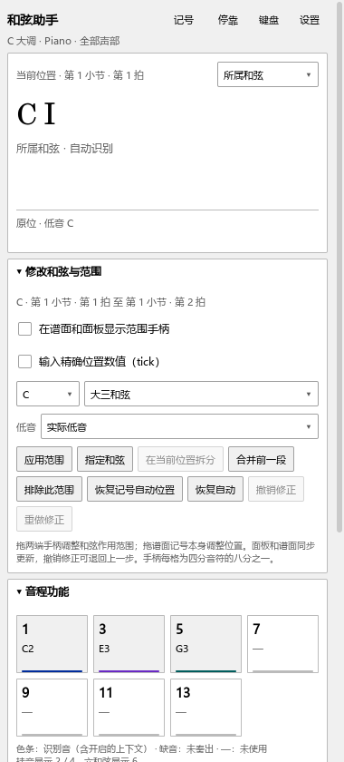
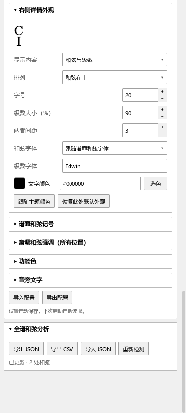
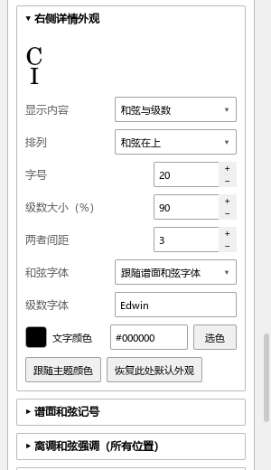

# 和弦助手：查看、修改和调整外观

适用版本：0.77.0 · Kumo branch / Freddd13。

## 打开并查看

1. 打开谱子，选择“视图 → 和弦助手”。
2. 点击一个音或开始播放，顶部摘要和详情显示当前位置的和弦、级数及转位。状态行显示读取、分析和已更新。
3. 在“谱面显示与着色”开启“谱面上方显示和弦 / 级数”，把分析结果显示在和弦变化的位置。

“所属和弦”显示这一整段的解释；“实时结果”根据当前位置的音判断。两处面板使用同一个选择。“空拍／未确定时保留上一和弦”在“设置 → 识别与调性”里，适合想让摘要持续显示的情况。

## 改一处和弦

例如想把第2拍的结果改为C大三和弦：

1. 暂停，在谱面点这一拍的音；也可双击它上方的和弦记号。
2. 当前和弦下方展开“修改和弦与范围”，选择C和“大三和弦”。低音可用“实际低音”，也可指定。
3. 点“指定和弦”，查看名称、级数和构成音。
4. 开启“在谱面和面板显示范围手柄”。拖两端调整作用的起止位置，或在小范围条里调整。
5. 需要移动文字时拖记号本身。范围手柄仍指向实际音乐位置。
6. Ctrl+Z撤销，Ctrl+Y重做。正常保存乐谱后，人工和弦、范围与文字位置一起保存。

“修改和弦与范围”可直接打开。双击谱面记号会展开这一组，保留其它设置的开合状态。长面板可以向下滚动。

修改范围内的音高、增删音或调整力度后，人工指定的和弦继续保留，构成音与功能着色读取当前谱子。增删小节、改变拍号或谱表后，面板提示核对起止位置；核对后点“复核完成：应用原人工范围”。撤销这次结构修改会恢复原范围。

## 分别调整三处显示

点详情顶部的“设置”，展开“外观、功能色与文字”。

| 想调整的位置 | 展开哪一组 | 可以调整什么 |
|---|---|---|
| 软件上方的小摘要 | 顶部摘要外观 | 位置、双面板、内容、字号、级数大小、间距、字体、颜色 |
| 右侧当前和弦标题 | 右侧详情外观 | 内容、字号、级数大小、间距、字体、颜色 |
| 实际乐谱上方的记号 | 谱面和弦记号 | 内容、排列、字体、相对大小、强调、避让与遮罩 |

摘要与详情均可选择“和弦在左／级数在左”作为一行，或“和弦在上／级数在上”作为两行；也可仅显示其中一项。设置中的样例随修改更新。每一处的“恢复此处默认外观”恢复当前这组。

“离调和弦强调（所有位置）”统一设置含调外音时的强调色，开启后三处使用这个强调色。“功能色”设置1、3、5等功能音的颜色；“音旁文字”设置各功能的名称。这些长设置可以分别展开和收起。

“实际音高”是可折叠的键盘；详情顶部“键盘”控制整组显隐。个人外观和开合状态自动保存，下次打开恢复。人工和弦和范围随当前谱子保存。

## 找不到结果时

先看顶部状态。分析完成后，检查“谱面上方显示和弦 / 级数”，并从“记号”打开逐段列表。原谱已有和弦时，“优先保留原谱和弦 / 级数”会保留这些记号，分析仍在面板可见。

问号也能双击修改；想重新采用算法结果时，在相应范围点“恢复自动”。

## 本批界面

