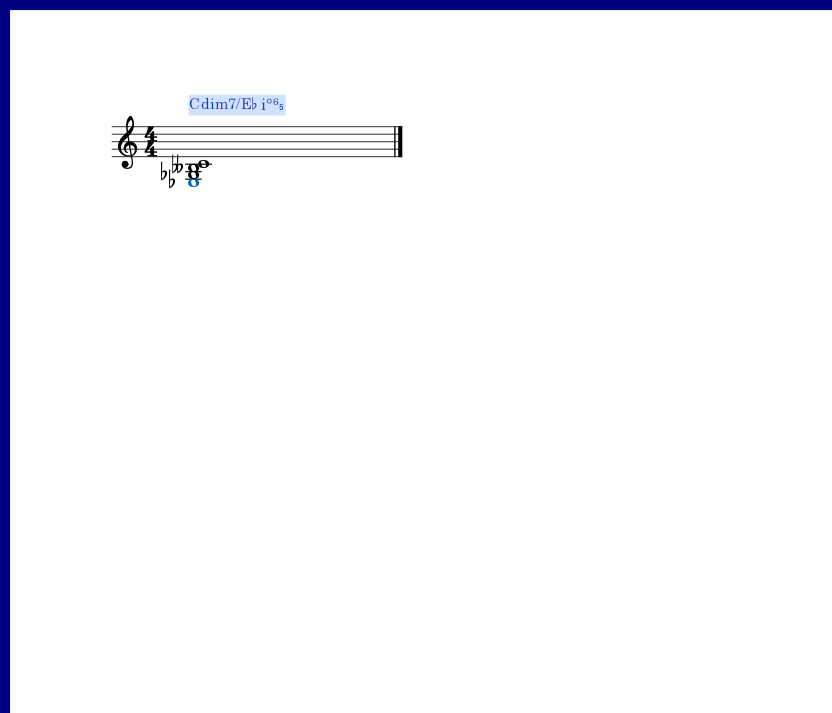
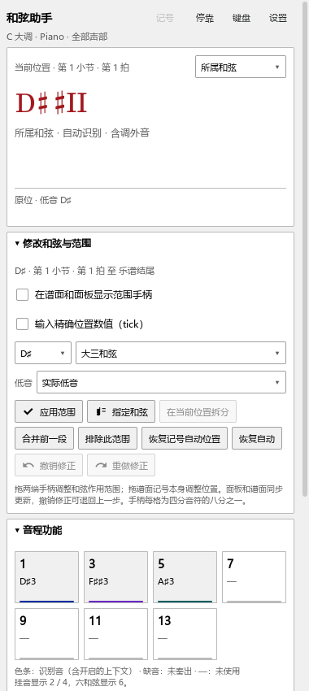

# 和弦的音名、低音和级数

适用版本：0.109.0 · Kumo branch / Freddd13。

## 打开后直接查看

打开乐谱，选择“视图 → 和弦助手”，点击要看的音或开始播放。状态行会依次显示读取、分析和更新结果。关闭最后一份谱后再打开新谱，面板会重新读取新谱。

顶部摘要与右侧详情可以选择“所属和弦”或“实时结果”。前者显示这一段的和弦解释，适合看分解和弦；后者显示当前位置的音。开启“谱面上方显示和弦 / 级数”后，记号显示在和弦开始处。

## 怎样读转位

以B7为例，它包含B、D♯、F♯、A。斜杠后面的音表示实际低音；级数旁的小数字表示转位。

| 实际最低音 | 和弦名称 | 在F♯大调中的级数 |
|---|---|---|
| B | B7 | IV7 |
| D♯ | B7/D♯ | IV⁶₅ |
| F♯ | B7/F♯ | IV⁴₃ |
| A | B7/A | IV⁴₂ |

当低音属于和弦构成音时，详情同时写出第几转位。低音是另一个音时，会单独写在斜杠后，例如C/F♯、I/F♯。

## 同一个琴键，音名为什么会影响结果

谱上D♯与E♭落在同一个琴键。在C大调中，D♯大三和弦写作♯II，E♭大三和弦写作♭III。助手现在一起读取谱上的音名和实际音高，让和弦名称与级数对应。

增三和弦、减七和弦的几个转位听起来容易相像。谱上E、G♯、C组成C+/E；E♭、G♭、B♭♭、C组成Cdim7/E♭。助手会用这些音的拼写帮助判断根音。

## 选择你要的解释

有些音组适合多种解释，例如C、E♭、G、B♭可以结合上下文理解为Cm7，也可以采用另一个六和弦解释。

1. 暂停，点击这一段的音，或双击谱面和弦记号。
2. 展开“修改和弦与范围”，选择根音、和弦种类与低音。
3. 点“指定和弦”，查看名称、级数和功能音。
4. 拖范围手柄调整起止位置；Ctrl+Z撤销，Ctrl+Y重做。
5. 正常保存乐谱，人工解释与范围一起保存，下次打开继续使用。

小调级数可以在“设置 → 识别与调性”中选择参照：A小调中的C和弦，按当前调式显示III，按同名大调显示♭III。

摘要、右侧详情、谱面外观及功能着色的完整操作见[和弦助手设置](HARMONY_077_GUIDE.md)。本批谱例与实际检查见[检查记录](HARMONY_109_CHECKS.md)。
