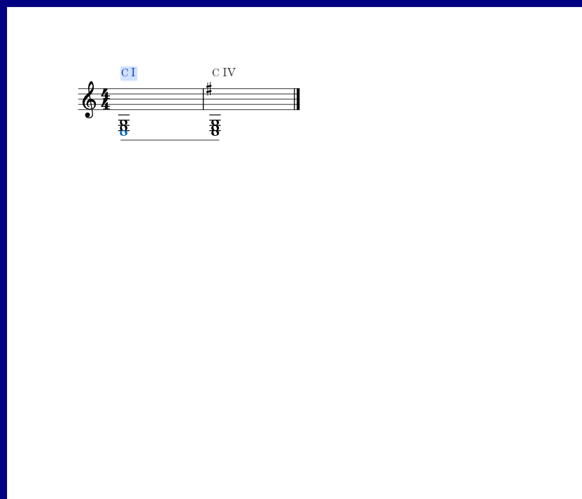
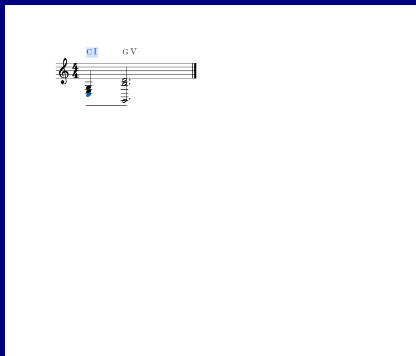

# 踏板内怎样划分和弦

适用版本：0.110.0 · Kumo branch / Freddd13。

## 根据写法选择单个或多个和弦

打开“视图 → 和弦助手”，点“设置”，展开“识别与调性”。“踏板内识别”有两个选择：

- **单个和弦**：把一次踏板内的分解音放在一起判断。适合低音、三音、五音依次弹出的伴奏，记号从这一段开始处显示。
- **多个和弦**：分别考虑新的低音和起音组。适合一个踏板中途改变伴奏的情况。

“踏板保持”控制是否把踏板留住的音纳入分析。“所属和弦”便于查看整段解释，“实时结果”便于查看当前音组。你的原有选项会继续保存。

例如先弹C、E、G，再在同一踏板内换成G、B、D：想按整段理解时选“单个和弦”，想标出中间变化时选“多个和弦”。旧低音若仍在按着，实际低音会继续显示；如果只由踏板留声，新音组的低音参与当前和弦判断。

## 已经指定或导入的解释

在“修改和弦与范围”指定的结果优先使用。导入已有分析文件时，文件明确分开的和弦也继续分开，即使当前选择了“单个和弦”。需要改变其中一段时，双击谱面记号，调整范围与名称；Ctrl+Z撤销，正常保存乐谱保留人工修改。

同一个踏板跨过调号变化时，和弦的名称可以保持，级数会按相应位置的调性更新。例如C和弦从C大调进入G大调，级数由I变为IV。

音名、转位与小调级数的例子见[和弦名称和级数](HARMONY_109_GUIDE.md)，三处外观与范围操作见[和弦助手设置](HARMONY_077_GUIDE.md)。
