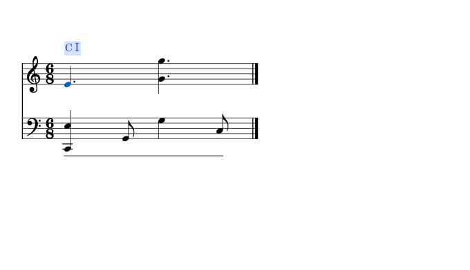
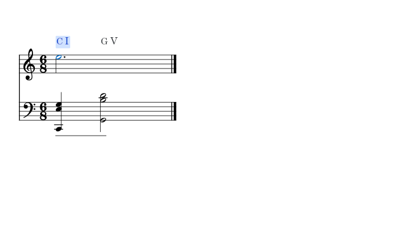

# 分解伴奏与和弦变化

适用版本：0.111.0 · Kumo branch / Freddd13。

## 连着看一段分解伴奏

1. 打开乐谱，选择“视图 → 和弦助手”。
2. 在当前和弦旁选择“所属和弦”。它会结合一段中陆续弹出的音，显示这一段的解释。
3. 点“设置”，展开“识别与调性”，将“踏板内识别”设为“多个和弦”。分析状态更新后，点击音符或开始播放。
4. 想在谱面一起看，开启“谱面上方显示和弦 / 级数”。

例如左手先同时弹C、E，再接G，右手重复较高的E、G：助手会把这些音放在一起判断，C和弦记号从伴奏开始处显示。右手的八度重复继续属于这一段。

## 中途换和弦时

一个踏板内，左手从C、E、G换到G、B、D，助手会比较新的低音和音组，在变化处建立新范围。右手原来的长音继续参与判断；实际仍按着的低音会写在斜杠后。

例如新和弦是G，而C低音仍然按着，会显示G/C。低音已经松开、由踏板留声时，新音组的低音用于当前和弦解释。

“单个和弦”仍适合整次踏板采用一个解释。两种方式及导入分析的用法见[踏板内的和弦](HARMONY_110_GUIDE.md)。

## 经过音与持续色彩

短暂的经过音、邻音会结合前后音和持续时间判断。持续的六音、七音或更高扩展音则参与和弦色彩；三音等主要构成音即使分开弹出，也参与整段识别。

“实时结果”便于看当前音组；“所属和弦”便于理解正在进行的伴奏。存在多种合理解释时，详情会列出备选。你可以双击谱面记号，在“修改和弦与范围”指定解释、调整范围，Ctrl+Z撤销，正常保存乐谱保留修改。

音名、转位和小调级数见[和弦名称和级数](HARMONY_109_GUIDE.md)，摘要、详情、字体和着色见[外观设置](HARMONY_077_GUIDE.md)。
