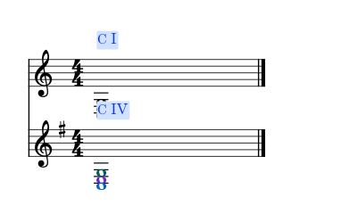

# 实时摘要、全谱调性与无踏板聚合

适用版本：0.112.0 · Kumo branch / Freddd13。

## 打开后直接查看

打开“视图 → 和弦助手”，点选音符或开始播放。选择“实时结果”后，顶部摘要和右侧详情会随当前位置更新。关闭最后一份乐谱、重新开谱后也能继续更新。

“所属和弦”显示已经识别的整段解释，适合分解伴奏和人工修改的范围；“实时结果”显示当前音组的解释。两种方式的和弦名称与级数各自使用同一份结果。

## 多件乐器一起检查

1. 点“设置”，展开“识别与调性”。
2. 将识别范围选为“全谱”。
3. 点击某件乐器的音符，摘要与详情显示这件乐器；谱面同时保留其它乐器的记号。

各乐器使用自己的调号。下例两架钢琴都弹C、E、G：第一架为C大调，显示C／I；第二架为G大调，显示C／IV。

钢琴的上下谱表仍合为一组。全谱识别按各乐器首个谱表的调号判断；手动指定主音后，所选范围统一采用这个主音。

## 没有踏板的分解音

在“识别与调性 → 无踏板聚合”选择“即时”“半拍”或“1拍”等长度。这里一拍采用四分音符长度。

例如依次弹C、E、G，每个起音间隔八分音符，选择“1拍”后，到G时可以一起判断C、E、G。当前只有G仍在持续时，实时结果显示C/G。聚合收集本小节最近弹出的音，同一声部遇到休止时结束。

快速更换和弦可以选较短的聚合长度；整次踏板的分析方式见[踏板内的和弦](HARMONY_110_GUIDE.md)，连续分解伴奏见[连续伴奏](HARMONY_111_GUIDE.md)。

人工和弦范围与位置继续随乐谱保存，Ctrl+Z撤销。分析文件保存根音与主音的升降号拼写，重新导入后继续用于级数显示。
