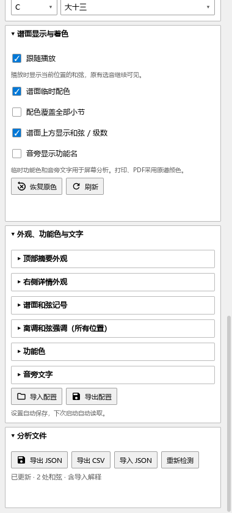
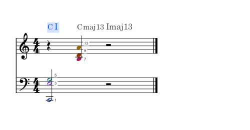
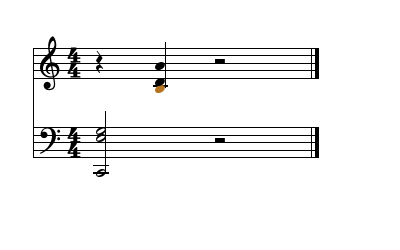

# 保存和重新采用和弦分析

适用版本：0.113.0 · Kumo branch / Freddd13。

## 把当前解释留在谱子里

在“视图 → 和弦助手”里指定和弦、调整范围、隐藏记号或移动文字后，正常保存乐谱。这些修改跟随当前谱子，下次打开继续使用。

从JSON导入的和弦解释也随谱保存。选择“所属和弦”查看整段解释，详情会标明“导入分析”。“实时结果”继续显示当前位置音组的判断。

## 导出一份分析文件

1. 打开要保存分析的乐谱，在“设置 → 识别与调性”选好“当前乐器”或“全谱”。
2. 等状态显示“已更新”，展开“分析文件”。
3. 点“导出 JSON”，选择位置并保存。

JSON保存和弦解释、人工修改、隐藏范围及记号位置，便于备份和重新采用。“导出 CSV”把各段的位置、名称和级数列成表，适合在表格软件中查看。

## 重新导入并查看

1. 打开对应乐谱，选回导出时的识别范围。
2. 在“设置 → 分析文件”点“导入 JSON”，选中保存的文件。
3. 查看按钮下方的结果提示。状态中的“含导入解释”说明文件中的解释已经载入。
4. 点选相关音符，或双击谱面和弦记号，检查解释与范围。
5. 正常保存乐谱。Ctrl+Z撤销本次导入，Ctrl+Y重做。

选择“当前乐器”时，导入和导出只处理这件乐器；其他乐器已有的解释和位置继续保留。

重新检测时，点这一组的“重新检测”。助手移除当前识别范围内导入的解释，按当前音符重新分析，同时保留你手动指定、隐藏或移动的内容。Ctrl+Z可以恢复刚才的导入解释。

旧版逐时刻分析文件也能导入，载入后转为有起止位置的解释，并沿用文件中保存的调性。例如，文件按A小调解释E7，导入后显示V7，详情同时写明“A小调”。手动指定主音后，级数和离调强调一起按所选调性更新；取消手动指定即可回到导入的调性。

文件与当前谱子或识别范围不符时，按提示切回导出时的乐谱和范围再导入。

## 单独保存外观

“外观、功能色与文字”中的“导出配置”“导入配置”用于字体、颜色、排列和个人设置。配置结果显示在这两个按钮附近；分析文件的结果显示在“分析文件”中。

三处显示的独立设置、折叠及恢复操作见[和弦助手外观](HARMONY_077_GUIDE.md)。

## 屏幕分析与打印

临时和弦、功能色和音旁文字用于屏幕分析。打印和PDF采用原谱，保留你手动设置的音符颜色。

