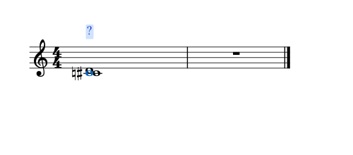
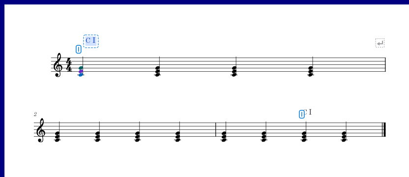

# 待指定和弦与范围修改

适用版本：0.114.0 · Kumo branch / Freddd13。

## 从问号开始指定

含三个以上不同音级的音组暂时无法确定名称时，谱面显示`?`。它也能直接打开修改。

1. 打开“视图 → 和弦助手”，开启“谱面上方显示和弦 / 级数”。
2. 暂停播放，双击问号。
3. 在展开的“修改和弦与范围”选择根音、和弦类型和低音，点“指定和弦”。
4. 查看谱面、摘要和详情中的结果，正常保存乐谱。

单音和暂时无法判断和弦的双音保留原来的简洁显示。要在这样的地方或休止位置添加解释，先点选音符或休止符，再在“修改和弦与范围”指定和弦。

## 增加、合并和隐藏一段

想在一段和弦中间增加变化：点选变化处的音，再点“在当前位置拆分”。两段可以分别指定名称和范围。

想把当前段接回前一段：点“合并前一段”。合并后采用前一段的解释。

“排除此范围”隐藏这段分析记号。要重新按音符检测，点“恢复自动”；原来无法确定的音组会重新显示问号。

“撤销修正”“重做修正”和乐谱的撤销、重做同步。每次指定、拆分、合并或隐藏都能单独退回。

## 从谱面或面板调整范围

打开“在谱面和面板显示范围手柄”。面板小条和谱面两端都可以拖动，修改后两边同步。

跨谱行时，把终点拖到下一行的对应拍位。终点落在小节边界时，手柄放在前一小节末尾。拖动和弦文字只改变文字位置，范围仍对应实际音乐位置。

保存乐谱后，人工解释、范围和文字位置一起保留。导入、备份和重新检测见[保存和重新采用和弦分析](HARMONY_113_GUIDE.md)。
