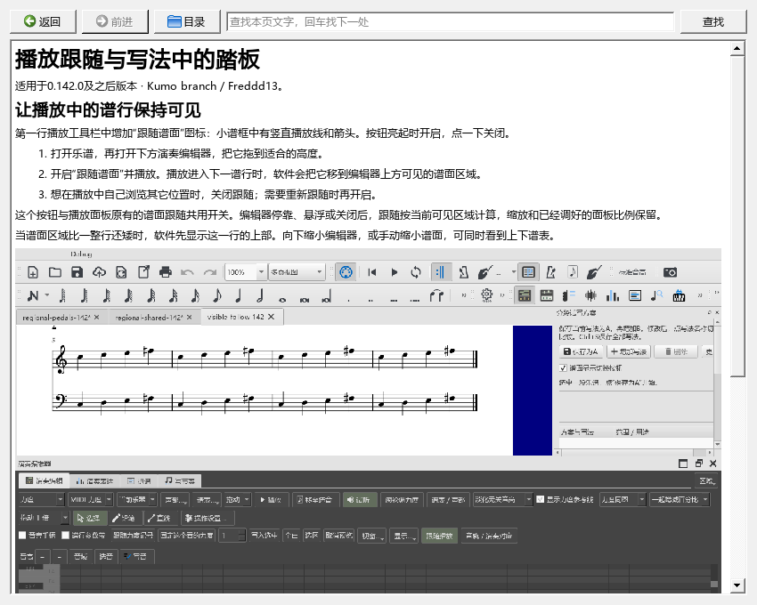

# 在软件里查阅功能说明

适用于0.146.0及之后版本 · Kumo branch / Freddd13。

## 打开和阅读

1. 打开“帮助 → 个人功能说明”。说明会出现在一个可移动、可调整大小的窗口里，乐谱仍可操作。
2. 在“想完成的事”中点击章节。例如，要处理编辑器挡住播放中的谱面，点击“播放跟随与写法中的踏板”。
3. 阅读后点击左上角“返回”，回到刚才的页面和阅读位置；“前进”可以再次打开离开的页面。
4. 点击“目录”回到功能列表。章节里的小标题链接会直接移到对应内容。

图片随窗口宽度缩小，保持原来的比例；调整窗口大小即可改变阅读空间。

## 查找一句话或一个按钮

按Ctrl+F，在右上角输入想找的文字，再按回车。匹配文字会被选中；再次回车查找下一处，翻到本页末尾后从开头继续。右侧“查找”按钮执行同一操作。

查找针对当前章节。需要换功能时，点击“目录”选择另一章。没有找到时，窗口底部会提示。

## 关闭和重新打开

按Esc或点窗口关闭按钮收起说明。从帮助菜单再次打开即可继续查阅。阅读保持乐谱的选音、播放位置和修改记录。

操作页和截图随程序安装。源码及研究资料由浏览器打开对应仓库页面；某个文件无法读取时，窗口会说明原因并保留正在阅读的页面。

## 本轮两个常用操作

- **播放跟随：**第一行播放工具栏的“跟随谱面”图标亮起后，当前谱行会移入下方编辑器上面的可见区域。点一下可关闭，再点一下重新跟随。
- **写法和踏板：**A、B各自保留音符与逐音演奏；踏板、力度记号和渐强渐弱共用。在任一写法里加踏板，切换后继续保留，Ctrl+S保存后重开也会保留。

详细步骤及谱面图见[播放跟随与写法中的踏板](FOLLOW_VARIANTS_142_GUIDE.md)。
