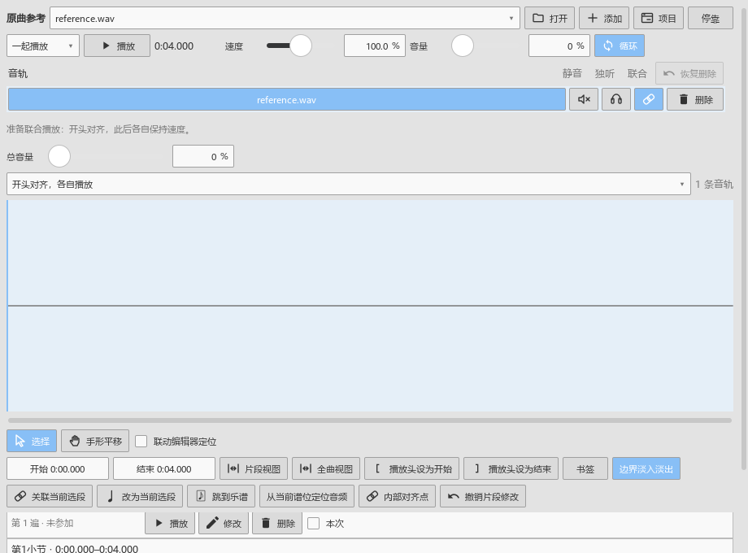

# 播放后继续使用面板

对应0.120.0。

打开“视图 → 原曲参考”，选好音轨，用“原曲”听录音，或用“一起播放”听关联的乐谱和录音。播放过程中可以继续查看编辑器；停止后，点击符号面板添加记号，照常使用撤销和重做。

本次修复了一个会让其它面板收不到点击的问题：在时间尺、力度区或卷帘里开始拖动，然后切到另一个工具窗口，编辑器会结束这次未完成的拖动并归还鼠标。原曲参考、符号面板和其它工具随后可以直接操作。

正常在同一个画布中拖动并松开，继续完成这次调整。时间尺定位、框选、平移和力度编辑沿用原来的操作及设置。

本轮整体进度和后续顺序见[当前进度](REWORK_PROGRESS.md)。
