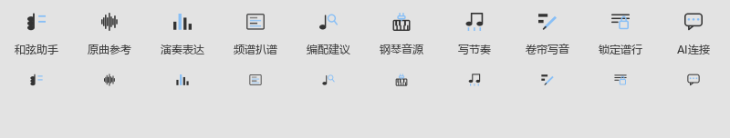

# 调整区域大小后继续操作

对应0.121.0。

谱行带边缘仍可上下拖动来改高度。松开后，原曲参考、符号面板和编辑器可以直接继续操作。播放或切换工具中断拖动时，窗口会及时归还鼠标；已经松键后的下一次移动或点击也会结束遗留手势。

本次修复了拉伸光标停住、其它面板收不到点击的一条路径。尺寸调整使用原来的高度设置；在同一个画布里正常拖动、松开，继续保存调整后的高度。

## 编曲工具栏

图标统一居中并跟随工具栏尺寸。波形表示“原曲参考”，力度柱表示“演奏表达”，带横向亮线的方框表示“频谱扒谱”，音符与放大镜表示“编配建议”，钢琴键与插头表示“钢琴音源”。和弦助手继续使用叠放音符，鼠标停在按钮上可查看名称。

打开位置、快捷键和个人布局沿用当前设置。整体进度和后续顺序见[当前进度](REWORK_PROGRESS.md)。
