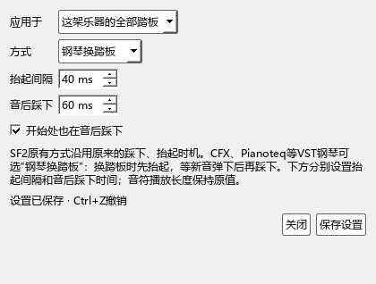
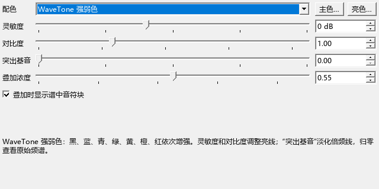

# 编辑器按键、钢琴踏板与频谱试音

适用于0.139.0 · Kumo branch / Freddd13。

## Esc取消选择，Home回到开头

1. 打开“视图 → 演奏编辑器”，在谱面或卷帘选中几个音。
2. 点一下卷帘、力度区或时间尺，按Esc，谱面与编辑器一起取消选择。拖动进行中时，第一次Esc取消这次拖动，再按一次清除选择。
3. 按Home回到乐谱开头。正在播放时从开头继续，编辑器恢复跟随；停止时只移动播放位置。原有写音状态先结束写音，再按Esc清除选择。

卷帘单独悬浮后，它上方的时间尺也支持这两个按键。输入文字和数值时，Home用于当前输入框。

## 给SF2或VST钢琴选踏板方式

打开演奏编辑器，将参数切到“延音踏板”。旁边的“踏板：SF2…”或“踏板：钢琴…”显示当前方式，点击打开设置。

1. “应用于”选择整架乐器或选中的踏板段；上下谱表属于同一架钢琴。
2. SF2可选“SF2原有方式”，继续使用原来的踩下、抬起时机。
3. CFX、Pianoteq等VST钢琴可选“钢琴换踏板”。“抬起间隔”控制换踏板时空出的时间；“音后踩下”控制新音弹下后等多久再踩踏板。初始值分别为40和60毫秒，可按音源听感调整。
4. “开始处也在音后踩下”决定独立踏板段的开头是否也这样处理。单段选“跟随这架乐器”可恢复整架钢琴的设置。
5. 点击“保存设置”，从相同位置播放比较。图中细轮廓是谱上范围，实线是实际踩踏范围。端点、段内移动、画间隙和重画仍可直接操作。

设置随乐谱保存，可用Ctrl+Z撤销。已有手动或连续踏板控制沿用原控制，面板会说明当前来源。音符原有起音和按键长度继续保留。

完整的端点操作、导出选项和示例见[踏板播放](PEDAL_106_GUIDE.md)及[踏板编辑](PEDAL_105_GUIDE.md)。

## 播放中滚轮调力度

在开启滚轮调力度后指向音符滚动，或按住Alt+Shift寻找视口内最近的音。浮标显示正在调整的音和力度。

播放中先显示修改后的值；停止播放后一次写入，一轮连续滚动对应一次撤销。停转后浮标短暂保留并淡出。Esc可取消尚在进行的这轮滚动。

## 频谱配色和右键试音

1. 在“原曲参考”打开音频，再切到演奏编辑器的“扒谱”。
2. 打开显示设置，在“配色”选择“WaveTone 强弱色”：黑、蓝、青、绿、黄、橙、红依次表示从弱到强。灵敏度调整亮线范围，对比度突出强弱差异；“突出基音”可淡化倍频线。
3. 在频谱上右键点击某个音高，就会用当前乐器试音。取音、循环、手形和标注工具都支持，原曲位置和循环保持原样。
4. 叠加时可调整“叠加浓度”，也可关闭“叠加时显示谱中音符块”。

已有配色按个人设置恢复；新设置首次采用WaveTone强弱色。参考[WaveTone官方操作说明](https://ackiesound.ifdef.jp/doc/wthelp/htuse1.html)。

原曲可以边放边试音。乐谱正在演奏时，先暂停乐谱再右键试音，画面会提示当前状态。试音通过当前音源发声，需要启用声音设备。
