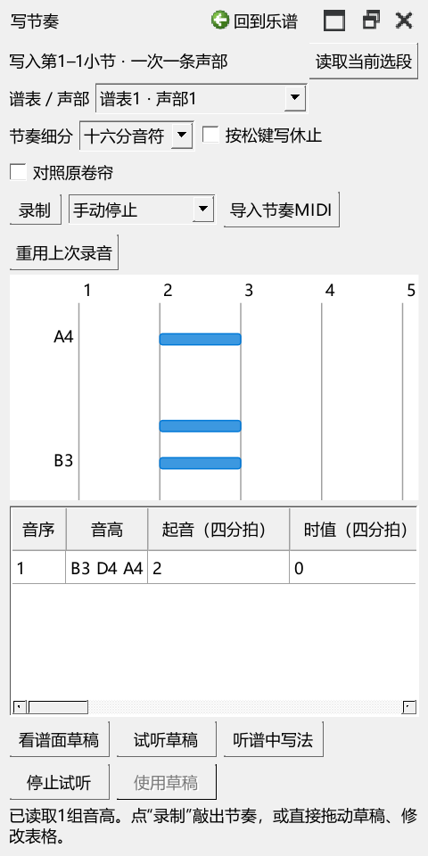

# 工作视图与工具布局检查

对应0.79.0。使用项目钢琴测试谱，在独立设置目录打开真实Qt工具页，并用鼠标操作分隔条、标签和按钮。现有用户设置仅复制编辑器和工作视图两部分；源文件保持只读。

## 修改前复现的操作

- 编曲中调好卷帘／力度区比例，切扒谱再回来，比例为0.405；连续三次切换编曲、DAW、雕版后，550像素的编辑器及比例仍保持。这组已经正常的行为继续保留。
- 首次进入雕版仍显示编辑器。
- 写节奏隐藏了包含工具页标签的整行，550像素的编辑器被压到480像素。
- 打开演奏表达时，740像素的编辑器被压到480像素。
- 写节奏悬浮后，主编辑器的时间滚动条未恢复；再点已悬浮工具的标签会挤占当前工具页。
- 写节奏的试听按钮被拉到249像素，文字所需宽度为56像素。
- 复制的现有设置恢复后，分隔区为212像素，最后一个可见区域延伸到220像素。按窗口宽度重新计算，原界面所需高度为439像素。进一步检查截图后，表达区改为至少180像素，以便直接看见主要操作。

复现日志：`usability-079-before-pluginhost.txt`、`usability-079d-before-pluginhost.txt`、`usability-079h-detached-before-pluginhost.txt`、`usability-079h-profile-before-pluginhost.txt`。中间修复和未通过的检查也保留在P2/out。

## 改动与查看画面

- 内容高度结合当前宽度和工具栏换行计算，显示和恢复尺寸后合并检查。已拉大的编辑器保持当前高度。
- 写节奏保留工具页与区域菜单，录制、细分、试听和采用按用途分组，窄窗换行。
- 独立工具与编辑器其它页可以共同使用。再次打开外置工具，主编辑器继续当前页。
- 悬浮的写节奏采用软件窗口主题；内部页采用编辑器主题。音条使用主题强调色，窗口失去焦点后仍保持可辨认的颜色。
- 演奏表达最小高度由80调整为180像素，让导入、录制、试听和使用力度处于可见区域。
- 初次雕版收起演奏编辑器和输入工具栏；已保存的个人摆放继续恢复。

用户操作见[窗口操作与区域高度](LAYOUT_079_GUIDE.md)。检查日志与安装文件摘要另存于本批交付JSON。

## 最终操作结果

- 常规布局、旧尺寸格式、工作视图、独立面板、原生颜色与频谱共16项操作，加初始化和结束共18项通过。日志：`P2/out/usability-079q-final-pluginhost.txt`。
- 150%显示缩放检查窄窗按钮、600／740像素编辑器和三种独立工具，加初始化和结束共5项通过。日志：`P2/out/usability-079q-dpi150-pluginhost.txt`。
- 复制现有编辑器与工作视图设置45项，检查首次恢复、内部区域、切换页和返回，加初始化和结束共3项通过。日志：`P2/out/usability-079p-profile-pluginhost.txt`。窗口恢复后编辑器为539像素，表达区至少180像素；原设置文件校验保持一致。
- 窄窗试听按钮由249像素恢复为56像素，320／720／1200像素宽度均检查换行和控件相交。
- 程序内计时MIDI输入后，实际点击录制、停止、使用力度并撤销，1项操作加初始化／结束共3项通过。日志：`P2/out/usability-079-recording-final-p1native-run.txt`。
- 原来正常的比例0.405与旧格式混合设置的0.399保持；三次视图往返保持550像素高度，打开表达保持600／740像素高度。
- 频谱仍可查看整条录音或对齐片段；缩放时滚动范围由15360变为8530 tick，关联的内部对齐位置保持。
- 早期固定等待200毫秒的检查可能在QML加载完、停靠布局尚待更新时读尺寸。现等待实际区域恢复到可见范围再读回，检查过程中只观察窗口变化。

本批使用真实Qt窗口和事件检查布局。录制到采用的检查使用程序内计时输入；声卡听感与实际键盘的完整使用过程继续记录在总返工清单。
