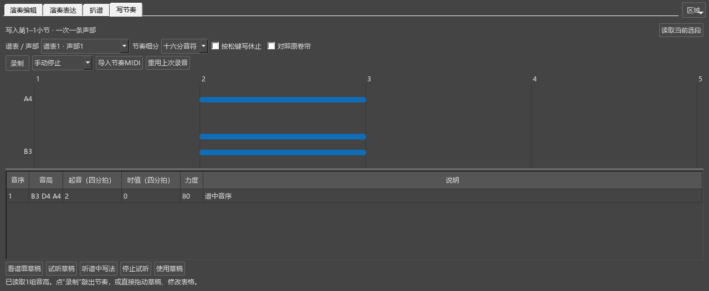

# 工作视图、工具页与编辑器大小

对应个人版本0.79.0。窗口布局随工作视图保存；乐谱中的修改照常用Ctrl+S保存。

## 调好大小，再切换工具

1. 从“视图 → 演奏编辑器”打开工具。
2. 拖编辑器与谱面之间的边缘，确定整个编辑器的高度。
3. 拖内部的分隔条，为卷帘和力度／速度区分配空间。
4. 点击“演奏表达”“扒谱”或“写节奏”，使用当前需要的工具；点“演奏编辑”返回。
5. 在“视图 → 工作视图”切换编曲、DAW、雕版或后处理，再回到编曲，继续使用原来的摆放。

打开工具时会按当前窗口宽度计算所需高度，让换行后的操作栏和底部内容都留在窗口内。已经调大的编辑器继续使用你选择的大小。演奏表达会为导入、录制、试听和使用力度留出可见高度，其余内容可在页内滚动。

## 从写节奏返回

写节奏页上方保留四个工具页标签，右侧保留“区域”。点“演奏编辑”即可回到力度等普通编辑；点“演奏表达”可以继续处理演奏。

想将写节奏单独放大，双击“写节奏”标签，或从“区域 → 写节奏 → 悬浮显示”移出。面板标题栏的全屏按钮可独占屏幕；再次点击或按Esc回到原尺寸。“放回编辑器”回到内部区域。

工具移出后，编辑器可以继续使用其它页。再点已移出的工具标签，会唤回它的独立窗口，编辑器保留当前页。写节奏中的录制、试听和采用按钮按文字宽度排列，缩窄面板时自动换行。

## 雕版与DAW的初始摆放

第一次进入雕版，会把主要空间留给乐谱，收起演奏编辑器和音符输入工具栏。需要调整演奏时，从“视图”重新打开编辑器；需要输入音符时，在工具栏空白处右键，勾选音符输入工具栏。

第一次进入DAW，演奏编辑器使用主要区域，音符输入工具栏收起。“视图 → 工作视图 → 显示乐谱对照”可同时看谱。

已经保存过的各视图继续恢复个人摆放。例如，在雕版里重新打开编辑器，切走再回来时它仍会打开。调整当前视图后，切换到其它视图会保存这次摆放。

## 调整区域与恢复

“区域”中可单独收起、打开、悬浮或移回卷帘、参数、演奏对应、演奏表达、频谱和写节奏。使用“恢复区域高度”可以重新分配内部空间，再拖分隔条调整。

悬浮、全屏与返回的完整步骤见[面板窗口](WINDOWS_072_GUIDE.md)；音符、参数和独立面板的组合例子见[工作视图与区域摆放](WORKSPACE_064_GUIDE.md)。
