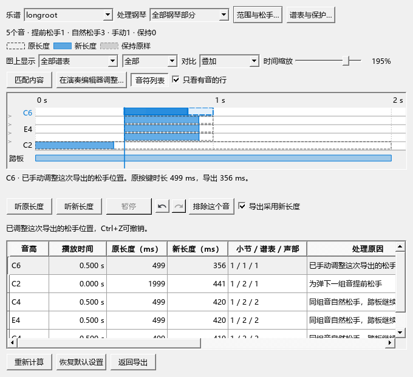
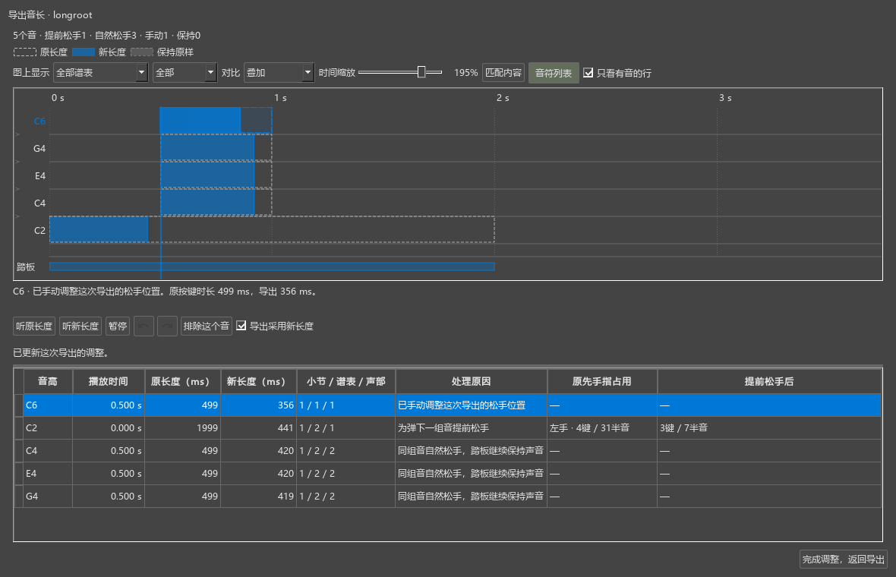
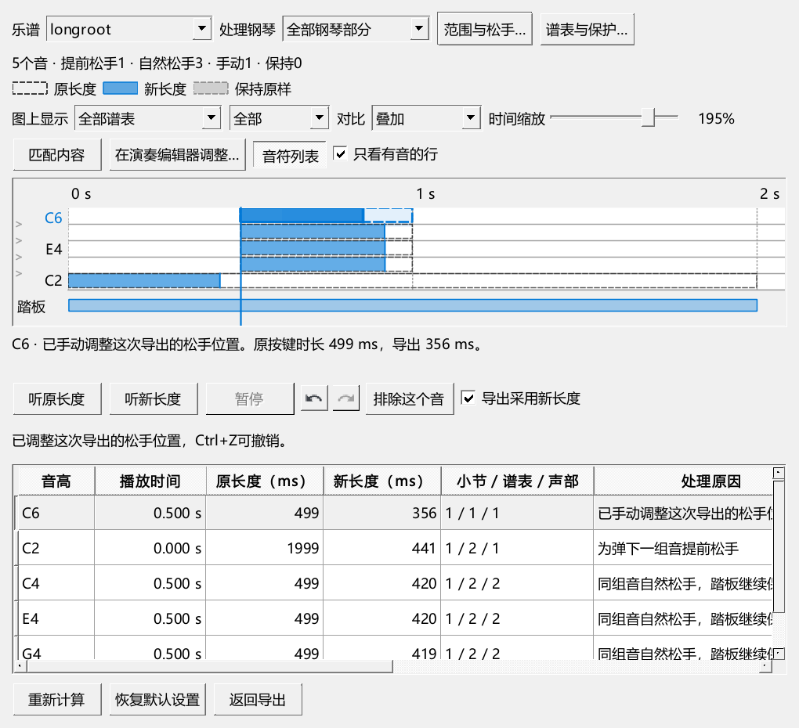

# MIDI 松手对比的操作检查

对应0.86.0。独立测试谱、导出文件、声音和图片保存在E盘，用户乐谱与个人设置保留。

## 发现和修复

先按“打开对比 → 拖松手点 → Ctrl+Z → 编辑器大图 → 返回 → 导出两份文件”操作。导出文件采用了手动位置，但Ctrl+Z没有撤销这次调整。复现记录在`P2/out/midi-086-reproduce-performanceeditor-run.txt`，其中两项准备／结束通过，一项操作失败。

现在每份谱的本轮导出有自己的调整记录，松手、排除及恢复都可撤销。比较窗口与编辑器大图共用记录；乐谱原有撤销和音符时值保持原状。

截图复查还发现，大图沿用了浅色说明区，说明文字难以阅读；小窗口和宽音域容易把低音挤出画面。现已统一大图内的文字、列表和控件配色，增加“只看有音的行”、可拖动的图表／列表分隔，以及列表开关。自动匹配随窗口高度调整，手动音高缩放继续保存。

试听原来会读取所选音之前的小节作为播放起点。现在先准备踏板和持续音，再从选定拍位进入声音与播放光标；原、新长度切换保留拍位。

## 实际操作

- 在680宽窗口点选音、拖松手点，核对导出参数和图中位置。
- 拖动中用Esc或Ctrl+Z取消，已完成的调整继续保留；完成后用Ctrl+Z／Ctrl+Y撤销、重做。
- 排除选中音，再撤销，原先的手动松手位置恢复。
- 收起、打开音符列表，实际拖动分隔条，检查宽音域中的低音与高音。
- 进入编辑器大图继续撤销、重做；返回后核对编辑器原位置、可见内容、乐谱标签数和撤销位置。
- 导出原、新两份MIDI，逐字节核对各自对应的事件和参数。原谱内容状态保持一致。
- 选择第三小节起播，经过后续小节，再切换原长度；核对实际播放序列的起点、输出音和当前拍位。
- 播放中选择另一个音查看详情；声音位置保持。暂停后点时间尺、按空格继续和暂停。
- 播完整段，自然结束后再次播放，检查按钮选中状态与实际声音对象。
- 回查反复中的逐次音长、保护声部、随机变化、同音配对及仅提前松手事件的规则。
- 以当前随包SF3钢琴渲染两份谱例，前后PCM的最大差值为0，保留输出WAV供进一步听辨。

普通窗口最终操作、150%显示缩放及频谱联动的结果见本页下方发布记录。GUI检查通过真实窗口内的鼠标和键盘事件完成；MIDI序列与SF3渲染用于核对声音数据，声卡听感仍在完整使用清单内。

## 界面

发布定位：`personal-v0.86.0`。

## 发布程序的最终检查

| 检查组 | 通过／失败 | 日志 |
|---|---|---|
| 窗口、撤销、导出文件、实际播放与版本标识 | 6／0 | midi-086-release-final-performanceeditor-run.txt |
| 反复、手调音长、编辑器往返和保护声部 | 5／0 | midi-086-release-final-p1native-run.txt |
| 时间换算、松手规则、事件保护、原生窗口和SF3渲染 | 8／0 | midi-086-release-final-p0native-run.txt |
| 150%显示缩放的鼠标、快捷键、布局及试听 | 4／0 | midi-086-dpi150-performanceeditor-run.txt |
| 原曲选段、整条录音与频谱共同缩放 | 4／0 | midi-086-spectrum-pluginhost.txt |

各组包含准备与结束。以上日志位于P2/out；已查看普通窗口与150%截图。原曲缩放页宽从15360变为8530，取音与既有显示方式继续保留。测试中原有QML Connections写法提示、模拟合成器的空效果提示继续记录。

