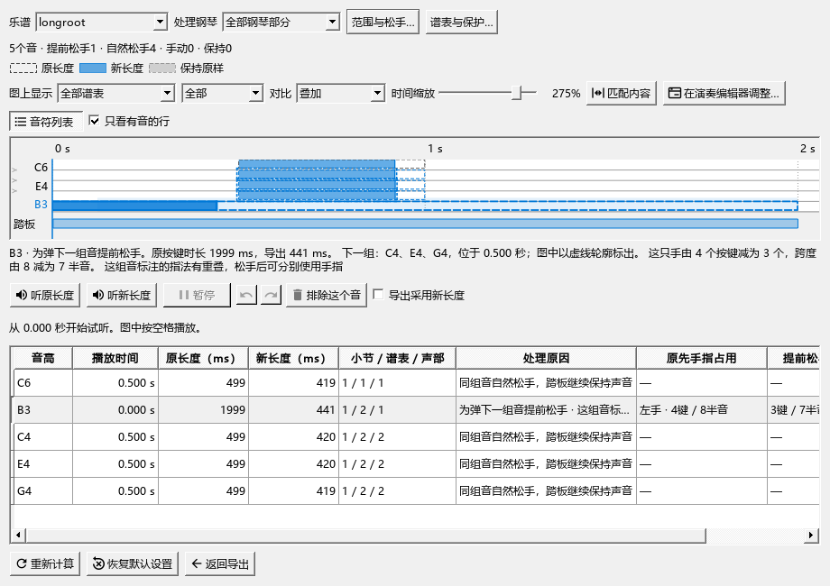

# MIDI松手处理：考虑已有分手和备选指法

这项修复已包含在 **0.129.0**，使用步骤如下；发布与后续检查见[当前进度](REWORK_PROGRESS.md)。

## 已有指法怎样参加计算

导出会读取单个音头上的数字指法、备选指法和括号指法。`2(3)`表示这个音可以用2指或3指，`[2]`按2指计算；原来的文字继续留在谱上。

例如左手保持B3，指法写着`2(3)`，下一组C4标2指、E4标3指。两个备选手指都要弹新音，就需要考虑先松B3。踏板能继续保持这个音时，对比窗口会显示提前松手，并说明指法占用的原因。

如果下一组只占用2指，3指仍能继续保持B3，计算就会保留这条可行的指法。随后依照你的自然松手设置处理按键长度。

## 查看和调整

1. “文件 → 导出”选择MIDI，勾选“人性化裁剪：保守踏板模式”，点“查看对比…”。
2. 点“匹配内容”，再点想核对的音。上方实心条显示新长度，细虚线框显示原长度。
3. 看图下方的说明。因为指法占用而松手时，会写“这组音标注的指法有重叠，松手后可分别使用手指”。下一组音和按键数量也在这里显示。
4. 用“听原长度”“听新长度”比较；需要微调时拖实心音条的右端，Ctrl+Z撤销这次调整。
5. 勾选“导出采用新长度”，点“返回导出”保存MIDI。

## 分手和需要核对的位置

左右手记号可附在音符、和弦或另一个符号上，导出读取时都保留其指向。同一音头上相互矛盾的指法会显示“这个音的指法互相冲突，保留原长度”；其它明确按键继续参加处理。

这些计算使用已有记号。导出和比较期间，谱上的指法、分手、音高、时值与演奏设置保持原样；主动保存乐谱后，原文字仍可继续修改。

本章介绍音头上的数字、备选与括号指法。延音中途的换手和`1-3`同音换指继续按C4-A2-B接入，完整进度见[总表](REWORK_PROGRESS.md)。窗口其它操作见[比较和调整松手位置](MIDI_086_GUIDE.md)，本批结果见[检查记录](MIDI_FINGER_CHECKS.md)。
