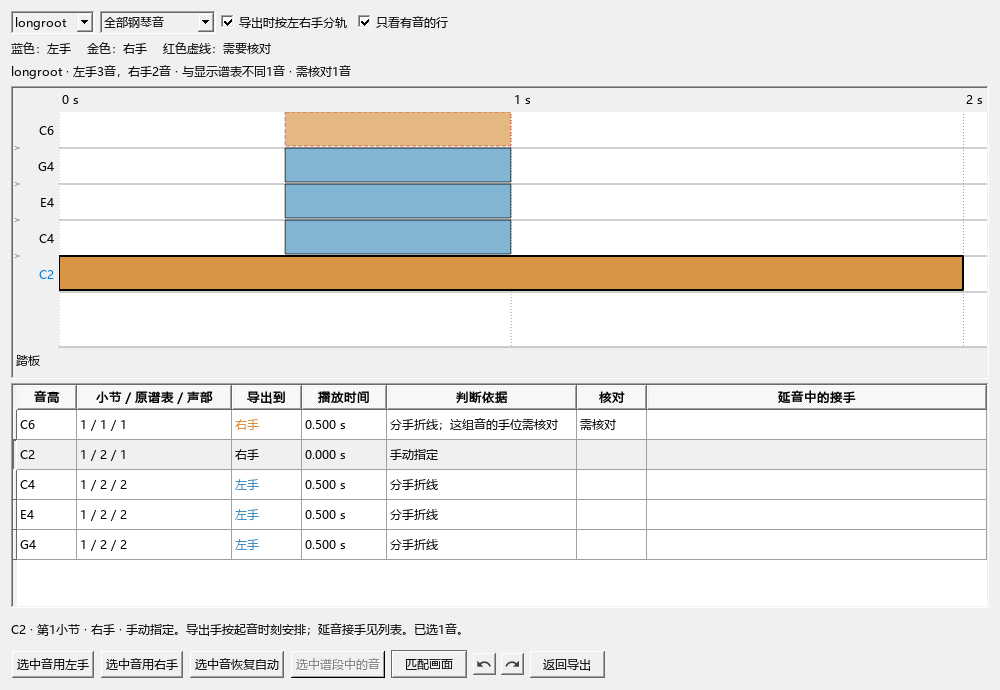
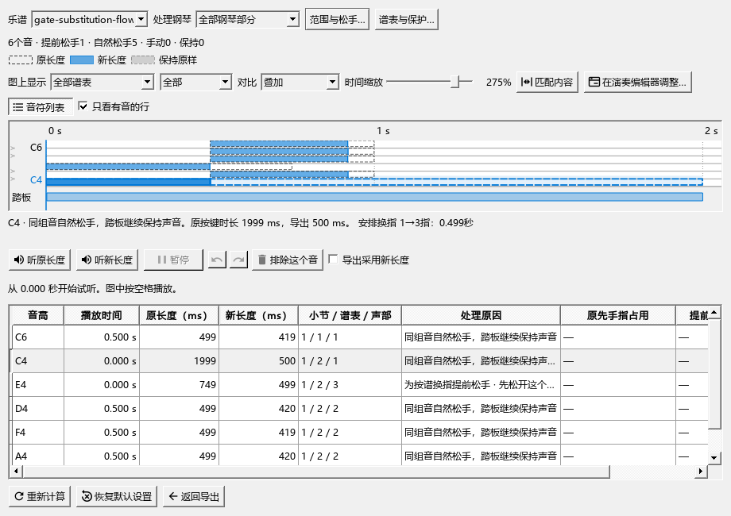

# 按实际左右手导出MIDI

本版：0.131.0 · Kumo branch / Freddd13。

## 第一次使用

1. 在乐谱中写好分手折线、r.h.／l.h.。跨谱表的音会同时读取它实际显示的谱表。
2. 打开“文件 → 导出”，选择MIDI，勾选“按实际左右手分轨”。
3. 点击“检查左右手…”。蓝色表示左手，金色表示右手；表格列出原小节、谱表、声部、导出手及判断依据。
4. 可以先选“与显示谱表不同”，检查为了记谱放在另一谱表的音；再选“需要核对”，查看说明有冲突或手位有疑问的位置。
5. 点音符，或在表格中按Ctrl／Shift选择多个音，点击“选中音用左手”或“选中音用右手”。改完可用Ctrl+Z撤销、重做按钮重做，也可点“选中音恢复自动”。
6. 点“返回导出”，导出MIDI。每件钢琴会得到名称带Left Hand和Right Hand的音轨，其它乐器继续保留。
7. 在Synthesia载入后，将Left Hand音轨指定给左手、Right Hand音轨指定给右手，按两手分别着色。

## 一次处理选段

先在谱面框选一段，再打开导出预览，点“选中谱段中的音”。这会选中该谱段在导出中的各次出现；随后点左手或右手，一次修改、一项撤销。

只想改反复中的某一遍时，按列表的“播放时间”选择那一遍对应的行。

“只看有音的行”收起没有音的音高行，方便检查分手。取消勾选可按完整音高查看。Ctrl+滚轮缩放时间，Shift+滚轮缩放音高，中键拖动画面；“匹配画面”回到全部内容。

## 程序怎样判断

人工指定优先采用。随后读取分手折线及音符旁的r.h.／l.h.；谱表文字从该位置起生效，遇到下一条左右手文字或ord.时更新。其余音综合实际显示的谱表、前后手位、已有指法、同时按键及踏板作安排。

“三手技巧”中的旋律、中间声部和低音可以继续按适合阅读的方式记谱，导出的音轨采用这里看到的分手。

延音中途换手时，音轨采用按下那一刻的手，后面哪一拍接手会显示在“延音中的接手”一列。

## 与人性化松手一起使用

“按实际左右手分轨”和“人性化裁剪：保守踏板模式”分别开关。只开分手，保留全部音符的起音、松键和力度；两项一起开启，松手计算也会使用你指定的手。

“检查左右手…”查看分手，“查看对比…”查看音长；两个窗口的人工分手共用。“同时导出处理前版本”另存一份原MIDI，便于对照。

这次导出中的人工安排在导出窗口关闭前保留。要让以后的导出也沿用某处固定分手，在谱上补分手折线或r.h.／l.h.并保存乐谱。

## 已检查与继续检查的部分

已用独立钢琴谱检查r.h.／l.h.、跨谱表、分手范围、成组修改、撤销重做、保存重开及实际MIDI轨名。分轨前后音符与控制事件一致，测试钢琴的SF3波形相同。Synthesia内的实际载入、手别颜色与真实音乐片段继续在目标软件检查。

Synthesia关于分手的操作见[官方说明](https://www.synthesiagame.com/support/guide/assignHands)。

## 同音换指与松手

谱上写1-3等同音换指时，松手判断会先等待目标手指空出；踏板允许时，可先释放占用该手指的其它音。图下显示换指的时刻和提前松手原因。手动恢复音长后，程序按新的占用重新计算整条路线。

