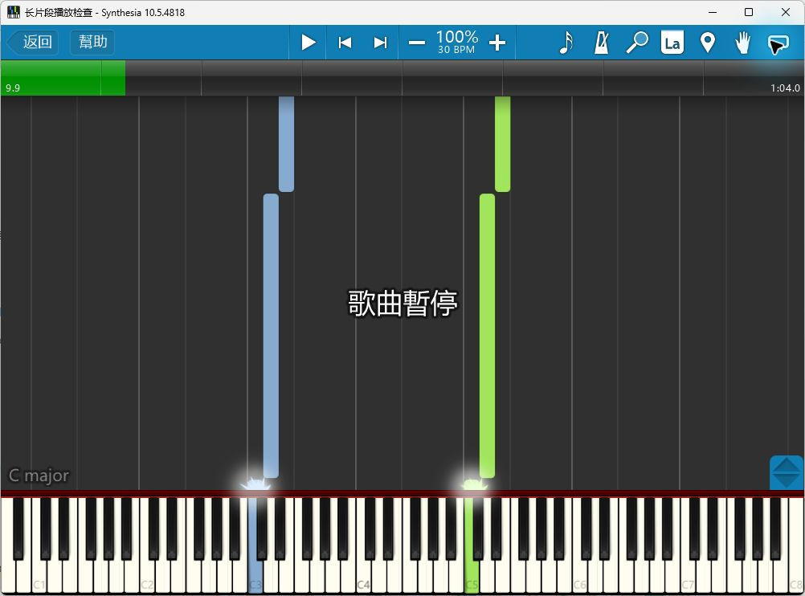
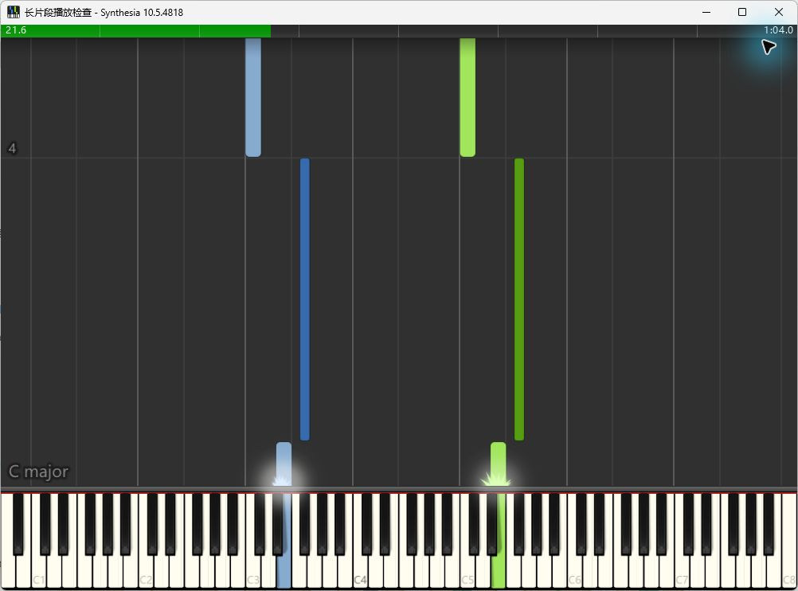

# F-EXPORT：Synthesia实际分手检查

日期：2026-10-31。首次分手检查使用0.156；下方长片段检查使用已安装的0.157，随包MCP2.7.2。

## 文件与操作

已交付版本的独立测试文件为P1/out/final-regression/midi-hand-preview.mid。SMF读取器与REAPER此前已确认：Right Hand轨含C2、C6两音，Left Hand轨含C4、E4、G4三音；全部起音、松手、力度与控制事件保持。

本次在Synthesia 10.5.4818中从该文件启动，打开“手、颜色和乐器”。它初次将2音组安排为左手、3音组安排为右手。逐组点手掌选择实际手别后，2音组为右手绿色，3音组为左手蓝色。回到曲目页后，再进入此页仍保留；随后进入“仅观看和听”，短片段播放结束返回曲目页。

官方的[曲目设置](https://www.synthesiagame.com/support/guide/songSetup)也通过手掌选择手别，再按“自动颜色”使用左右手配色。说明已补充每组试听、音符数量与导出预览的对照步骤。

## 原因核对与未发布实验

初次把默认手别归因于轨道创建次序，判断过早。曾在独立编译中试验左轨在前、右轨在后；实际打开后手别结果相同，该实验未证明所猜原因。相关源码、测试和版本已经恢复0.156，实验资料保留在P2/out/export157。正式程序及稳定ZIP未替换。

实验中的7个导出情景通过，包含原有手动分配与窗口操作；这些结果只作为调查资料。实际发布版本的判断仍以原始MIDI、REAPER读回及本次Synthesia操作为准。用户原谱未修改。

## 后续

本项已补齐目标播放器的打开、两手分组、颜色、音条、暂停、继续、返回开头、完整播放和再次播放。CFX厂商操作见[本次音源检查](CFX_PANEL_157_CHECKS.md)；实体键盘与真实声卡听感继续按[完整进度](REWORK_PROGRESS.md)安排。

## 0.157长片段：暂停、回到开头和重播

使用0.157原生导出一份独立测试谱，30 BPM、64秒、64个起音与64个松键。原始MSCZ和用户原谱保持原样，测试谱及MIDI保存在P2/out/synthesia157。

| 实际操作 | 看到的结果 |
|---|---|
| 进入“仅观看和听” | 蓝、绿两组音条及对应琴键显示，长音条随播放向下移动 |
| 播放中按空格 | 9.9秒显示“歌曲暂停”；稍后再次查看仍为9.9秒 |
| 点上方播放键 | 从同一位置继续，观察到10.3秒 |
| 再按空格 | 49.8秒暂停 |
| 点时间轴左端 | 回到0.0秒，保持暂停 |
| 按空格从开头播放 | 完整播放后自然返回曲目设置页 |
| 再点“继续” | 再次进入播放，观察到21.6秒及两手音条 |

两次坐标点按暂停后未出现暂停画面，本项以空格核对暂停、播放键核对继续。原始操作结果保留在observations.json，声音听感继续单列核对。

当前WinMM查询为0个MIDI输入、2个声音输出。程序与完整ZIP保持0.157，本次结果同步到安装说明。
