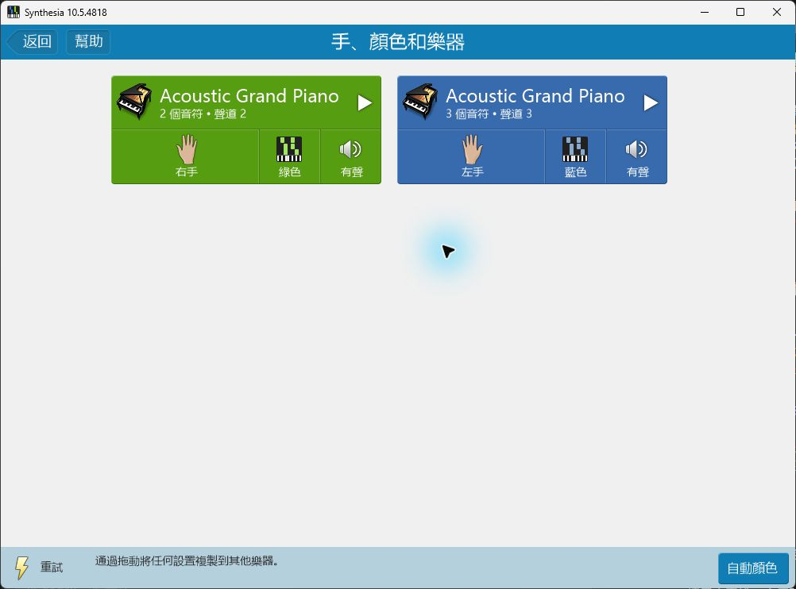

# F-EXPORT：Synthesia实际分手检查

日期：2026-10-31。正式程序和稳定包保持0.156，随包MCP2.7.2。

## 文件与操作

已交付版本的独立测试文件为P1/out/final-regression/midi-hand-preview.mid。SMF读取器与REAPER此前已确认：Right Hand轨含C2、C6两音，Left Hand轨含C4、E4、G4三音；全部起音、松手、力度与控制事件保持。

本次在Synthesia 10.5.4818中从该文件启动，打开“手、颜色和乐器”。它初次将2音组安排为左手、3音组安排为右手。逐组点手掌选择实际手别后，2音组为右手绿色，3音组为左手蓝色。回到曲目页后，再进入此页仍保留；随后进入“仅观看和听”，短片段播放结束返回曲目页。

官方的[曲目设置](https://www.synthesiagame.com/support/guide/songSetup)也通过手掌选择手别，再按“自动颜色”使用左右手配色。说明已补充每组试听、音符数量与导出预览的对照步骤。

## 原因核对与未发布实验

初次把默认手别归因于轨道创建次序，判断过早。曾在独立编译中试验左轨在前、右轨在后；实际打开后手别结果相同，该实验未证明所猜原因。相关源码、测试和版本已经恢复0.156，实验资料保留在P2/out/export157。正式程序及稳定ZIP未替换。

实验中的7个导出情景通过，包含原有手动分配与窗口操作；这些结果只作为调查资料。实际发布版本的判断仍以原始MIDI、REAPER读回及本次Synthesia操作为准。用户原谱未修改。

## 后续

本项补齐目标播放器的打开、两手分组、设置颜色及短片段自然结束。较长音乐的连续听感、暂停／重播及Synthesia音长动态显示继续随F-AUDIO检查；实体键盘和CFX厂商窗口按用户安排进行。
