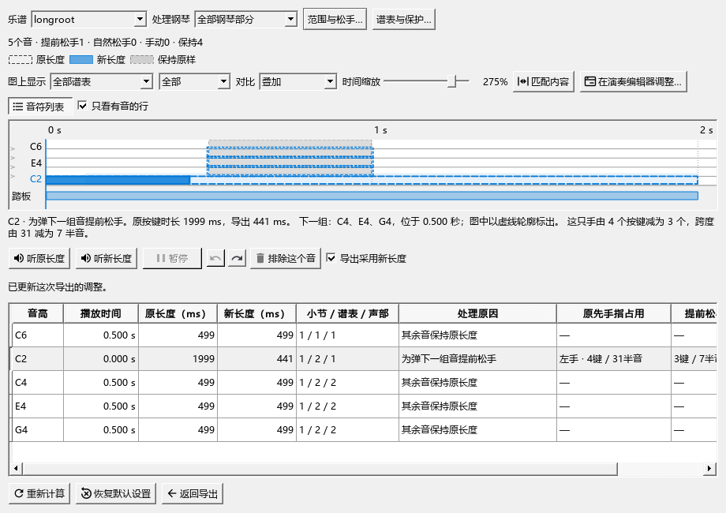
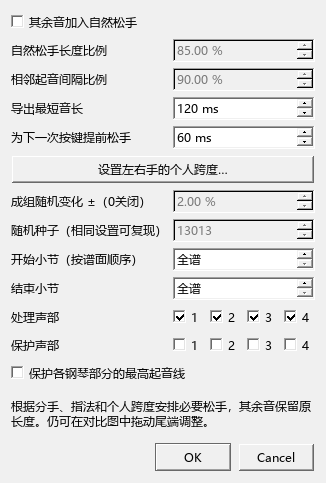

# MIDI松手：只处理腾手需要，或加入自然变化

本版：0.132.0 · Kumo branch / Freddd13。

## 只想处理影响后面弹奏的保持音

例如左手C2写满一小节，下一拍要弹C4、E4、G4。踏板能继续保持低音时，可以提前松开C2，手指再去弹下一组音。

1. 打开“文件 → 导出”，格式选MIDI，勾选“人性化裁剪：保守踏板模式”。
2. 点击“裁剪设置…”，关闭“其余音加入自然松手”。
3. 检查“导出最短音长”和“为下一次按键提前松手”，以及个人跨度、处理声部和保护声部，然后确认设置。
4. 点击“查看对比…”，再点“匹配内容”。程序按已标分手、指法、按键占用和踏板，安排需要提前松开的旧音。
5. 点低音C2，查看“为弹下一组音提前松手”和下一组的音名。细框保留原长度，实心条表示导出长度；其它音显示“其余音保持原长度”。
6. 点“听原长度”与“听新长度”比较；需要调整时直接拖实心条的尾端。Ctrl+Z撤销，Ctrl+Y重做。“排除这个音”让它采用原长度。
7. 勾选“导出采用新长度”，点“返回导出”保存MIDI。“同时导出处理前版本”可以一并保存原MIDI。

## 希望其余音也有自然松手变化

在“裁剪设置…”开启“其余音加入自然松手”。这是原有默认方式，已有设置继续沿用。

- “自然松手长度比例”决定一般音符保留多少按键时间，默认85%。
- “相邻起音间隔比例”根据下一次起音安排松手，默认90%。
- “成组随机变化”让同一只手同时弹下的音共同变化，每个音再带很小的差别。设为0可关闭随机。
- “随机种子”用于重复得到相同结果；同一份输入和相同参数导出一致。

关闭自然松手后，上述四项变为灰色；最短按键时间、个人跨度和保护设置继续生效。窗口下方的说明会随开关更新。

## 这一版怎样选择需要松开的音

程序先比较满足下一组音所需的松键办法，优先少改音。需要松开同样数量的琴键时，再比较提前了多长时间，尽量保留还要持续较久的音。同音多声部按一个琴键考虑。

能唯一对应的相接同音会正常处理。分手有疑问的音在列表中保留提示；其余已经确定的按键继续计算。

“三手技巧”等复杂分手可先点“检查左右手…”校正，再打开音长对比，两处使用同一份人工分手。

## 踏板与预览

导出窗口中的“导出谱上原始踏板”也用于准备音长对比。开启后按谱面踏板时机计算；关闭时采用乐谱中设置的钢琴换踏板时机。

设置可以取消，导出中的尾端调整可以撤销。人工音长调整保留在当前导出过程中；谱面时值仍按原来的写法保存。

更完整的图例、大窗口调整和播放操作见[比较与调整松手位置](MIDI_086_GUIDE.md)。接下来继续核对导出反复设置、暂停和提前起音下的试听位置，进度见[当前安排](REWORK_PROGRESS.md)。
