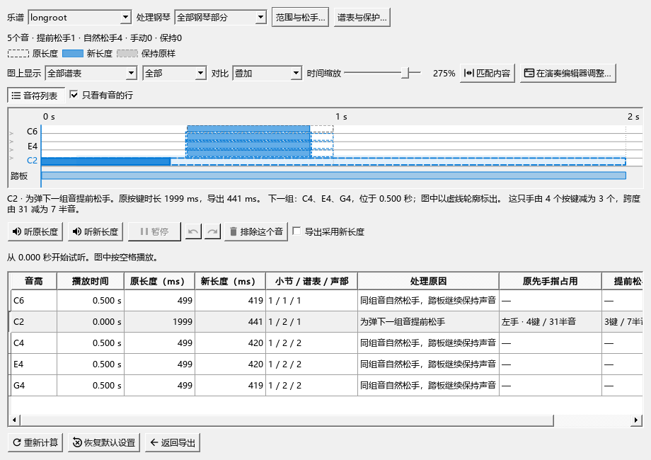

# MIDI松手处理：按实际按键考虑前后衔接

本批源码已检查，尚未安装。当前使用0.128.0，更新安排见[当前进度](REWORK_PROGRESS.md)。

## 这次改善了什么

处理松手时，会同时比较左右手前后的位置，以及旧音实际何时松键。例如左手刚弹完低音，右手早已空出，下一音在两手之间时，计算会考虑右手有更充足的移动时间。已经指定的分手继续使用。

计算读取MIDI中的实际起音、松键与速度变化。在踏板允许保持发声的范围内安排提前松手，谱上的音长照常保留。

## 从导出到比较

1. “文件 → 导出”选择MIDI，勾选“人性化裁剪：保守踏板模式”，点“查看对比…”。
2. 用“范围与松手…”设置要处理的小节和最短按键时间；“谱表与保护…”选择参与处理的声部。
3. 点“匹配内容”，再点一个提前松开的音。图中细虚线框显示原长度，实心条显示导出长度，下面列出下一组音和手指占用。
4. 例如左手C2写满一小节，随后要弹C4、E4、G4：踏板保持低音时，可以先松C2。说明会写“为弹下一组音提前松手”，并显示原先4个按键减为3个、跨度由31半音减为7半音。
5. 用“听原长度”“听新长度”比较，再勾选“导出采用新长度”，点“返回导出”保存文件。

## 继续调整

拖动实心音条的右端可以调整本次导出的松手位置，淡色范围表示当前允许的位置。Ctrl+Z撤销这次调整，Ctrl+Y重做；“排除这个音”让所选音保留原长度。

完整的图例、两种对照、大窗口调整与试听操作见[比较和调整松手位置](MIDI_086_GUIDE.md)。本批结果及后续安排见[检查记录](MIDI_RELEASE_PHYSICAL_CHECKS.md)。
