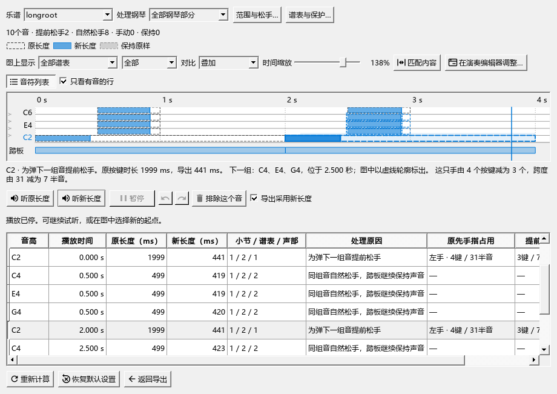

# MIDI导出：反复、试听与时间位置

适用于0.134.0 · Kumo branch / Freddd13。

## 导出一段反复，并比较原、新音长

1. 打开“文件 → 导出”，格式选MIDI，勾选“展开反复”。程序会按乐谱中的反复顺序生成文件。
2. 需要安排松手时，勾选“人性化裁剪：保守踏板模式”，点“查看对比…”。需要检查分手时，使用“按实际左右手分轨”旁的“检查左右手…”。
3. 在音长对比中点“匹配内容”，查看整段。相同小节的第二遍会出现在后面的播放时间；可点对应音符或下方列表定位。
4. 点“听原长度”或“听新长度”。两个按钮从当前声音位置切换；点“暂停”后，再点其中一个继续。图中空格执行播放／暂停，点击时间尺可换起点。
5. 拖动实心条的尾端调整这次导出的松手位置，Ctrl+Z撤销、Ctrl+Y重做。图下方写出所选音的时间、处理原因及下一组音。
6. 保持“导出采用新长度”勾选，点“返回导出”，再保存MIDI。勾选“同时导出处理前版本”可一并保存原长度文件。

## 改动反复或RPN选项

这两个选项以导出窗口当前的勾选为准。刚修改后打开对比，立即能看到新的结果。乐谱平时是否播放反复，可继续按原来的播放设置使用。

试听覆盖这次文件中展开的全部遍次。点第二遍的音，从第二遍开始；原新切换、暂停续播和重新计算都保留当前试听位置。播放到末尾后，按钮和状态文字回到停止状态。

在“检查左右手…”指定过的音，以及拖过的松手尾端，会继续对应原来的音。切换RPN不会打乱它们；关闭反复后保留第一遍仍存在的调整。

## 开头有提前起音、暂停或速度变化

例如第一拍之前有200毫秒的提前起音，文件从这个提前音开始，谱子的第一拍位于文件的200毫秒处。点击图中100毫秒，试听从提前起音区的中间开始；暂停、继续和原新切换保持这个位置。

文件中有一条“Kumo: score first beat”定位标记，指出谱面第一拍。歌词、排练标记、踏板和后续速度变化按各自在谱中的时机保存。遇到暂停，后面的内容会一起后移；展开反复后，每次出现分别对应。

## 保存与恢复

尾端及手别调整属于当前导出过程；谱面时值、音高与力度按原谱保存。关闭对比后，普通播放恢复原有反复选择。需要重新选择自动结果时，使用对比内的恢复入口；操作细节见[比较与调整松手位置](MIDI_086_GUIDE.md)及[左右手导出](MIDI_HAND_EXPORT_GUIDE.md)。
