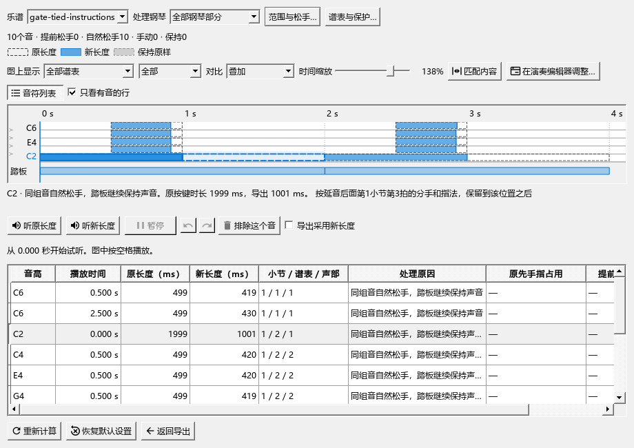

# 延音中的分手、指法与 MIDI 松手

本版为 **0.130.0 · Kumo branch / Freddd13**。

## 怎样使用

1. 在延音后面的音头写好分手或指法。例如C2用延音线保持一小节，在第三拍写右手接过、指法2。
2. “文件 → 导出”选择MIDI，勾选“人性化裁剪：保守踏板模式”，点击“查看对比…”。
3. 点C2。图下会说明要保留到第几小节、第几拍；实心条是导出的按键长度，细框是原长度。
4. 拖实心条尾端调整松手。允许范围会保留后面的分手、指法及最短按键时长；仍可排除这个音，保持原长度。
5. 点“返回导出”，按当前设置导出。这里的调整作用于导出的演奏，谱面时值继续保留。

## 这一版修复了什么

导出沿完整延音链读取分手和指法。后半段明确写了要接手或使用某个手指，会保持到该处，再考虑后面的松手；之后的手位按接手的手和指法计算。

展开反复时，各遍分别使用自己的播放位置。暂停造成的导出时间补偿也一起换算；已经松键之后的记号继续留在谱上，按键判断使用实际演奏范围。

保存乐谱时，这些分手和指法仍按原方式保存。导出及查看对比会保持乐谱原有的保存状态和撤销位置。

同音换指如“1-3”的实施时间已在0.131.0补齐，操作见[换指与导出](MIDI_HAND_EXPORT_GUIDE.md#同音换指与松手)；当前进度见[进度与后续安排](REWORK_PROGRESS.md)。已有备选指法如“2(3)”见[使用说明](MIDI_FINGER_GUIDE.md)。

