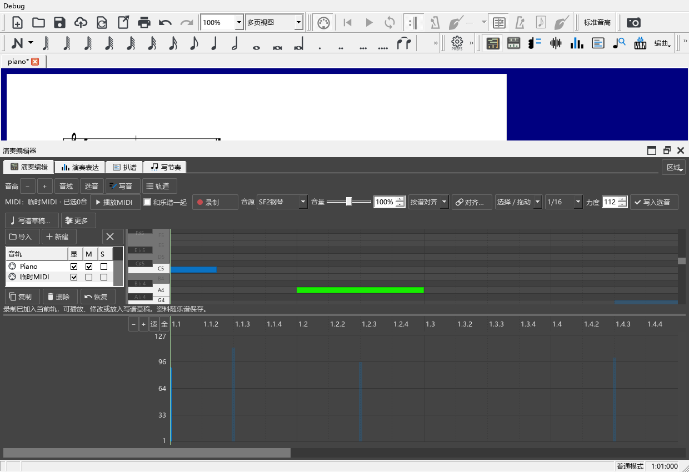

# 外部 MIDI 与临时写作轨

适用版本 0.160.0 · Kumo branch / Freddd13。

MIDI 轨用来对照分离乐器、自动扒谱或自己的演奏，也可以临时画音、试力度。每条轨都有自己的音符和声音设置。乐谱轨继续显示当前乐谱；把 MIDI 放入“写谱草稿”并点击“使用草稿”后，所选位置才会写入乐谱。

## 导入一份 MIDI，和乐谱对照

1. 打开乐谱，选择“视图 → MIDI轨道”。演奏编辑器卷帘左侧出现音轨列表。
2. 点击“导入”，选择 `.mid` 或 `.midi`。文件中的音符轨分别加入列表，原文件也随乐谱保存。
3. 点击轨名，将它设为当前编辑轨。蓝色音符和下方力度柱属于这条轨；其它 MIDI 轨淡化显示。
4. 导入时 M 列已经勾选。先检查音符所在位置，再取消 M，点击“播放MIDI”。再次点击停止。
5. 勾选“和乐谱一起”，从当前时间尺位置比较两边。原曲音频仍使用“原曲参考”中的播放入口。

联合播放以谱尾为终点；选择了具体原曲关联时，以那段关联的范围比较。MIDI仍完整保留，取消“和乐谱一起”可以单独听整条轨。

| 列或控件 | 用途 |
|---|---|
| 显 | 显示这条轨的音符 |
| M | 静音 |
| S | 独听；可以同时独听几条轨 |
| 音源 | SF2钢琴，或某一谱表当前使用的音源 |
| 音量 | 调整当前 MIDI 轨的播放音量 |
| 乐谱行 | 控制乐谱音符的显示、静音和独听 |

选择谱表的 VST 音源时，MIDI 轨使用独立声音实例。停止参考轨时，谱面钢琴的按键和踏板继续由乐谱控制。

## 对齐录音、MIDI 和谱子

“录音时间”保留 MIDI 的实际秒数。“按谱对齐”根据原曲关联，把音符放到对应谱位。

1. 选择 MIDI 轨，点击“对齐…”。
2. 在“对应录音／谱段”选择原曲音轨，或它的一条谱段关联。
3. 调整“整体偏移”。例如 MIDI 比原曲早 0.2 秒，将偏移设为 **+0.200 秒**。
4. 两边速度逐渐错开时，添加“内部对齐点”：左列填 MIDI 时间，右列填原曲中同一音的时间。两列按先后排列。
5. 点击“应用”。切换到“按谱对齐”，检查谱位。修改原曲关联后，这里的对应位置一起更新。
6. “解除关联”清除选定录音、偏移和内部对齐点；点击“应用”保存这一调整。Ctrl+Z 可恢复。

数字框可直接输入，也可用上下键细调。原曲片段有多个出现位置时，选择具体关联及遍次。

## 在临时轨写音和录制

1. 点击“新建”，建立“临时MIDI”。双击轨名可改名。
2. 选择“画音”，在卷帘拖出一个音；网格可选自由、十六分、八分或八分三连音。
3. 切回“选择／拖动”：拖主体移动，拖左右端改变按键起止；框选或 Ctrl 点选可选多个音。
4. 上下键改半音，Shift＋上下键改八度；左右键按当前网格移动，Alt＋左右键按 10 毫秒细调。
5. 拖下方力度柱，或输入“力度”后点“写入选音”。复制、剪切、粘贴使用 Ctrl+C／X／V；粘贴位置由时间尺确定。
6. 点击“录制”，弹奏后点“停止录制”。录制结果直接加入当前轨，保留按键、松键、力度和踏板。

轨道列表或卷帘获得焦点时，空格播放／停止；录制中按空格结束录制。修改名称和输入数字时，键盘继续用于文字与数值输入。

录制使用软件当前的 MIDI 输入设备。设备尚未连接时，面板显示具体原因。原录制还可从“更多 → 导入最近录制…”找回。

## 把一条轨放入乐谱

1. 选择要使用的 MIDI 轨；只想使用几个音时，先在卷帘选中它们。
2. 点击“写谱草稿…”，选择目标谱表、声部及范围，点“查看草稿”。
3. 检查草稿的网格、休止和声部。记谱时值会对齐网格，原来的细微演奏时间和力度继续保留。
4. 用“谱中效果／草稿效果”比较，再点击“使用草稿”。
5. Ctrl+Z 撤销这次写入。MIDI 轨继续保留，可以回去调整后再生成草稿。

“MIDI覆盖的小节”采用当前谱中已有的小节；超出范围的音会在提示中列出数量。可以先在乐谱增加所需小节，再生成草稿。

## 删除、恢复、导出和保存

- 点击“删除”移除当前 MIDI 轨；点击“恢复”找回最近移除的轨，也可使用 Ctrl+Z／Ctrl+Y。
- “复制”保留当前轨的音符及对齐，便于尝试不同编辑。
- “更多 → 导出当前轨（MIDI时间）…”保留编辑后的 MIDI 秒数。
- “更多 → 导出当前轨（原曲对齐时间）…”将偏移和内部对齐换算到文件中。
- Ctrl+S 将原始 MIDI、编辑结果、音轨、音源选择和对齐一起保存在 MSCZ 中。原曲音频仍从原位置读取。
- 点左侧关闭按钮可收起轨道列表；“视图 → MIDI轨道”重新打开。选择列表中的“乐谱”回到普通演奏编辑。

每次画音、拖动、改力度、删除或对齐各对应一次撤销。只浏览、选择和试听时，保存状态保持原样。
