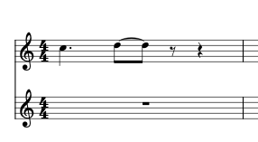
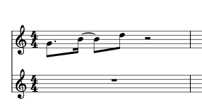
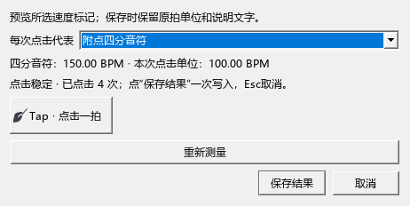

# 输入时值、Tap与渐慢：完整操作

适用于0.135.0 · Kumo branch / Freddd13。

## 先打开时值整理

选择“工具 → 自动规范输入时值”。勾选后，新输入和改变时值都会按当前拍号整理。菜单中的“允许延音音符跨拍连符杠”和“协调延音两端的自动符干”分别控制符杠与自动符干方向。

这些勾选是个人设置，会记住上次选择；已有设置继续沿用。音符时值、延音线和手动净谱保存到乐谱。另一套软件会采用它自己的自动排版设置。

## 例一：附点四分后，把八分改成四分

1. 在4/4的第一拍，选四分音符、附点，输入一个音。
2. 选八分音符，输入第二个音。
3. 结束写音，选中第二个音，再点四分音符按钮。
4. 第二个音拆为跨过小节中点的两个八分，以延音线连接，总时值仍为四分。
5. 希望这两个八分共用符杠时，勾选“工具 → 允许延音音符跨拍连符杠”。关闭时按拍位分开；手动指定的符杠继续保留。

选错时值可按Ctrl+Z撤销，再按Ctrl+Y重做。连符杠的选择只改变显示，播放音长保持原时值。

## 例二：附点八分＋附点八分＋八分

在同样的4/4第一拍开始，依次输入这三个时值。中间的附点八分在需要的位置拆为十六分加八分，并用延音线相连。

开启“协调延音两端的自动符干”后，紧凑音组会结合相邻符杠采用协调的自动方向。需要自己的写法时，选中音再指定符干或符杠；手动设置随谱保存。

## 用Tap修改已有速度

1. 选中速度标记，在检视器或右键菜单点“用 Tap 设置速度”。
2. 核对“每次点击代表”的拍单位，跟着希望的速度敲至少四次。
3. 窗口和谱面同时显示预览。每次点附点四分，若点击速度是100，换算成四分音符就是150。
4. 点“保存结果”或回车，一次写入；Esc或“取消”回到原来的速度。Ctrl+Z可撤销保存。

原来的拍单位、说明文字、加粗和斜体会保留，只更新速度数值。≈、≒、ca.和小数也支持。同拍有多个速度标记时，保存会更新选中的那一个，实际播放采用它的新速度；同拍其它文字保留。速度对该位置的全部声部生效。

只测速度时，使用节拍器旁的敲击图标及下拉设置。要新增速度标记，在乐谱选中音符或休止符，再选“写入指定位置”。

## rit.和a tempo

选中一段，从速度面板添加“渐慢 rit.（可播放）”。在检视器调整起速、终速、文字和线条；从菜单或面板添加的新rit.采用当前谱子的速度文字字体、字号和字形，续行文字也使用同一套设置。个人自定义字体继续保留，可单独修改。

末端落在小节线时，对应的是前一小节的右边。选中线条，拖末端手柄可调整显示位置；跨行会分段显示。一次拖动一次撤销，保存重开保留范围和位置。

在恢复位置选中音符或休止符，添加“a tempo（恢复渐变前的速度）”，再播放整段。隐藏虚线仍会按设定渐慢。

旧工作区读取后，默认速度格子整理为一条rit.和一条a tempo；自己制作的格子继续保留。当前工作区的核对结果见[检查记录](NOTATION_135_CHECKS.md)。
