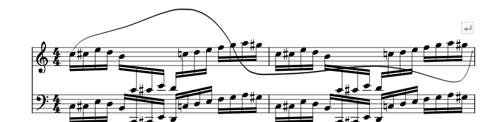

# D3：圆滑线与其它演奏记号

2026-10-29，0.137.0 · Kumo branch / Freddd13。

## 查到的问题与修改

- 两端都在上谱表、途中音符跨到下谱表时，曲线只收集两端所在谱表的障碍。用真实下谱表音头单独核对，原来的点停在音头中心，报告碰撞0；修正后自动移开5.625谱间，所存节点资料保持。
- 密集谱例的数据与切线连续检查通过，但图中仍有尖折。指定上下绕行时，按实际乐句计算可用距离；固定点保持，局部受限时继续计算其它位置的平滑路线。相同谱例改后曲线连接连续，截图与PDF一起保留。
- “逐次力度”用具体百分比说明，保留既有预设与保存值。说明区分发音符号倍率对跟随记号的音的作用，以及逐音固定值与震音逐次力度。

## 实际操作

- notation137-formal-editor：28 passed, 0 failed, 0 skipped, 0 blacklisted, 20171ms。
- notation137-formal-midi：21 passed, 0 failed, 0 skipped, 0 blacklisted, 1851ms。
- notation137-formal-p0：8 passed, 0 failed, 0 skipped, 0 blacklisted, 18416ms。
- notation137-formal-host：4 passed, 0 failed, 0 skipped, 0 blacklisted, 34408ms。

- 新谱例为上下两表、四小节、128个十六分音符，包含升号、加线、途中换表及强制换行。普通与前上后下两种路线均比较节点顺序、连接切线、连续排版、保存重开和真实MIDI事件。
- 较大谱表距离的独立谱例，中间位置绕到8.546谱间，碰撞0；起点、终点及其手调切线保持原值。普通未指定路线的曲线仍采用原有搜索范围。
- 五类检视器从实际点击开始：琶音与小音符应用预设，重音编辑倍率，震音和颤音选择逐次力度；键入数值、一次撤销／重做、存MSCZ并重新读取，各属性和完整起音／松键事件一致。
- 原有曲线拖点、端点、切线、节点锁定、局部整理、跨谱表、跨行及链接分谱一起回查。正式日志无QPainter绘图警告。
- 琶音、小音符核对首拍提前、从段中开始、循环、延音与反复。轻重音核对相对／绝对力度；颤音与震音核对逐次力度、链接分谱、生成事件和8192次起音。
- 回查分手导出、原MIDI路径、停播后符号面板和原曲面板点击。实体键盘、声卡听感与厂商窗口仍按用户安排在F继续。

## 数学检查与实际谱图

切线连续只证明连接处方向一致，实际谱图仍要检查弯曲、距离和局部碰撞。固定节点与指定路线冲突时，检视器会保留需要调整的提示；可移动节点、改变该段走向或解除锁定继续整理。

候选曲线的碰撞、斜率和高度分别比较，参考[LilyPond圆滑线说明](https://lilypond.org/doc/v2.26/Documentation/internals/slur_002dinterface)。本项目保留多段曲线、手动节点及局部路线。

## 文件与后续

首次复现：notation137-crossstaff-isolated-before-pluginhost.txt；修正：notation137-crossstaff-fixed-pluginhost.txt。形状比较：notation137-routing-trial、notation137-routing-fair。正式四组结果：P2/out/notation137-formal-checks.json。

完整操作见[圆滑线与演奏记号](NOTATION_137_GUIDE.md)。接着D4字体与行锁定，再按E1—E4、F继续。

正式程序已安装：PDF 7446字节，MIDI 181字节、6音。个人配置、Qt绘图组件、MCP及Codex配置保持原内容。
