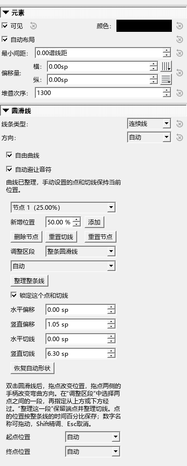
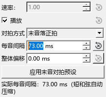
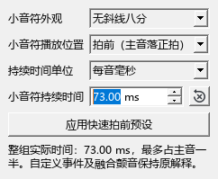
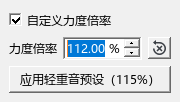
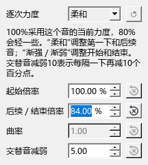

# 圆滑线与演奏记号：形状、时机和力度

适用于0.137.0 · Kumo branch / Freddd13。

## 让圆滑线从上方、下方平顺地经过

先选好起止音，添加圆滑线，再点选线条，打开检视器。

1. 勾选“自由曲线”和“自动避让音符”。
2. 两端需要贴在不同侧时，分别设置“起点位置”“终点位置”。例如起点用“音符上方”，终点用“音符下方”。
3. 在“新增位置”输入50%，点“添加”。中间的小方点将曲线分成两段。
4. “调整区段”选“起点 → 点1”，下方走向选“从音符上方经过”；再选“点1 → 终点”，改为“从音符下方经过”。
5. 双击线条。拖中间点改位置，拖两侧的手柄调弯曲；相邻两段会共用连接方向。
6. 想让一个点继续参与避让，取消“锁定这个点和切线”。想保留当前位置，重新勾选。点“整理这一段”整理连接，点的位置继续保留。
7. 保存乐谱，重开检查。节点、锁定、两端位置和每段的走向都会保存；Ctrl+Z撤销一次修改，编辑菜单中的“重做”恢复。

“自动”端点会结合首尾区段的走向。“恢复自动形状”清除中间点，重新整理曲线；两端位置设置继续保留。“删除节点”删除当前选中的点。

跨谱表时，自动避让会读取乐句中途经过的谱表，包括先跨到下谱表、后来又回到上谱表的情况。跨行后，各行继续使用相应区段的走向。密集处可多加一个点，把绕行位置放在有空隙的地方。

## 琶音：让最后一个音落在拍上

1. 在和弦上添加琶音符号，点选琶音线。
2. 在检视器的“对拍方式”选“末音落正拍”。
3. “每音间隔”先试65 ms，“整体偏移”设0 ms。
4. 从这一和弦前面播放，听低音到高音依次进入。升向三音和弦的三个音约在拍前130 ms、拍前65 ms和拍上弹下。
5. 想让最低音从拍上开始，改成“首音落正拍”。下行琶音按照高到低的顺序采用相同规则。
6. 保存后参数随琶音保留。Ctrl+Z撤销；拖数字旁的参数名称可以连续调，Shift配合拖动细调，拖动中Esc取消。

“整体偏移”移动整组的演奏时间：负数提前，正数延后。“实际每音间隔”显示真正采用的间隔；音符很短时会压缩，给后面的演奏留出位置。

跨两个谱表的琶音线会把其覆盖的音作为一组计算。“原伸缩比”沿用原来的琶音播放，“应用末音对拍预设”一次设置末音落正拍、65 ms、整体偏移0 ms。

## 小音符：选择在拍前、拍上或主音末端弹

1. 添加小音符，选中它或相连的主音，在检视器找到“小音符播放位置”。
2. 选择“拍前（主音落正拍）”。
3. “持续时间单位”选“每音毫秒”，持续时间先试65 ms。两个小音符就各弹约65 ms，主音仍落在原拍点。
4. 从前一拍播放检查。“应用快速拍前预设”可以一次恢复这套常用设置。
5. 保存乐谱。Ctrl+Z撤销，数字旁的恢复按钮恢复对应参数。

其它位置的含义：

| 选项 | 听到的效果 |
|---|---|
| 原倚音解释 | 使用MuseScore原有的倚音播放 |
| 拍前（主音落正拍） | 小音符先弹，主音留在拍上 |
| 拍上（延后主音） | 小音符从拍上开始，主音随后进入 |
| 拍后（主音末端） | 主音先响，小音符放在它的末端 |

“整组占主音比例”按整组分配时间，例如20%表示整组占主音时长的五分之一。“整组实际时间”显示短音符等限制下真正采用的时间。小音符的外观可单独选择。

## 轻重音：按百分比改变这个记号的效果

先把音的力度设为“跟随力度记号”，再选中重音符号，在检视器开启“自定义力度倍率”。例如该处力度记号给出的数值为80，115%得到92；80%得到64。已经固定力度的音保留指定值，可在演奏编辑器中逐音调整。

先播放听一个音，再选择同类记号一起修改。“应用轻重音预设（115%）”可恢复常用效果；新加的相应重音采用这个预设。已有记号的设置随谱保存，Ctrl+Z撤销。

## 颤音、震音：让连续音有轻重和走势

1. 添加震音或颤音，点选对应符号或线条，找到检视器的“逐次力度”。
2. 先选“柔和”。“起始倍率”调第一下，“后续／结束倍率”调后面的音。
3. 想逐渐收弱，选“渐弱”，例如开始100%、结束80%。选择“渐强”则逐渐增强。
4. “交替音减弱”让来回音有轻重。例如减弱10表示交替音的倍率再减少10个百分点。
5. 播放比较。用“曲率”调整变化出现得早一些或晚一些；数值1是均匀变化。
6. 保存乐谱。Ctrl+Z撤销；下拉框旁的回转箭头重新应用当前预设。“原样”采用原来的逐次演奏。

这里的100%采用该音当前力度，固定力度的音也按这个值计算。“自定义”用于自己调整起始、结束和曲率；已经手工编辑过播放事件的音继续采用那些事件。

## 改了设置后怎样核对

每次先选中对应符号，再看检视器。播放中调整的演奏参数会在停播后写入；保存前停播，可以核对最后的数值。

演奏编辑器会显示生成音的实际力度范围。需要恢复普通力度时，先选中音符调整其力度，再核对发音符号或震音的百分比；这两层设置会共同影响最后听到的力度。

本批具体谱例、实际播放事件和保存检查见[检查记录](NOTATION_137_CHECKS.md)。
