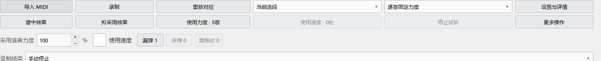

# 和弦助手与演奏表达：从软件里直接打开

## 查看和弦

1. 打开乐谱，在“视图”菜单点“和弦助手”。右侧会出现和弦详情，与检视器等工具并列为标签页。
2. 点选音符或播放，查看当前和弦、级数和转位。谱面记号、顶部摘要继续使用原来的开关。
3. 需要更改和弦解释时，暂停播放，双击谱面和弦记号。拖动范围手柄修改作用范围，拖记号主体调整位置。
4. 修改可以用 Ctrl+Z 撤销；人工和弦、范围和位置随 MSCZ 保存。

再次点击“视图 → 和弦助手”可以隐藏详情，重新打开会回到原位置。原“插件 → Harmony Assistant”也打开同一个工具。已有字体、颜色、摘要位置及显示设置继续使用。

## 把演奏 MIDI 的力度用到谱子

1. 在谱面选中要调整的一段。
2. 点“视图 → 演奏表达”。软件会打开演奏编辑器，并切到上方的“演奏表达”页。
3. 点“导入 MIDI”选择演奏文件。全曲 MIDI 会寻找当前选段；也可以点“录制”，用 MIDI 键盘弹奏后停止。
4. 对应完成后，在力度区查看两根并列柱：中性色是谱中力度，强调色是拟采用力度。可以拖强调色柱修改预览。
5. 点“谱中效果”或“拟采用效果”比较听感；“停止试听”停止播放。
6. 选择“选中音／当前选段／全部已对应范围”，点“使用力度”。需要速度变化时，勾选“使用速度”，查看并试听候选后点“使用速度”按钮。
7. Ctrl+Z 撤销这次采用。点“更多操作 → 恢复应用前力度”，可以恢复之前随谱保存的原力度。

新导入默认采用 100% 演奏力度。例：谱中力度 80、演奏力度 100，100%采用 100，50%采用约 90。已有项目恢复自己保存的比例。

“逐音固定力度”直接保存每个音的 MIDI 力度；“继续跟随力度记号”换算成每个音的相对增减，以后修改 p、mf 或渐强渐弱时一起变化。“保留原保存方式”沿用各音当前的保存方法。

## 录制、核对与项目

“录制结束”可以选择手动停止、到时停止或弹完选段停止。录制与对应的详细设置放在“设置与详情”。

“漏弹／多弹／需核对”按钮用于查看具体位置；“更多操作 → 在编辑器调整对应”展开对应区，可以修改配对关系。

“更多操作”还提供打开、保存表达项目和设备校准。表达项目保留原始 MIDI、对应及尚未采用的预览；采用后的演奏值随乐谱保存。

## 收起和再次打开

点击编辑器上方“演奏编辑”收起表达操作区，继续平常的力度、速度和踏板编辑。再点“演奏表达”会回到刚才的项目。拖动操作区与其它区域之间的分隔条可以调整高度。

当前没有演奏材料时，试听和采用按钮显示灰色。导入 MIDI 或完成录制后，按钮会随可用结果启用。乐谱修改后，点“重新对应”更新当前预览。

版本：0.58.0 · Kumo branch / Freddd13。提交定位：personal-v0.58.0。
