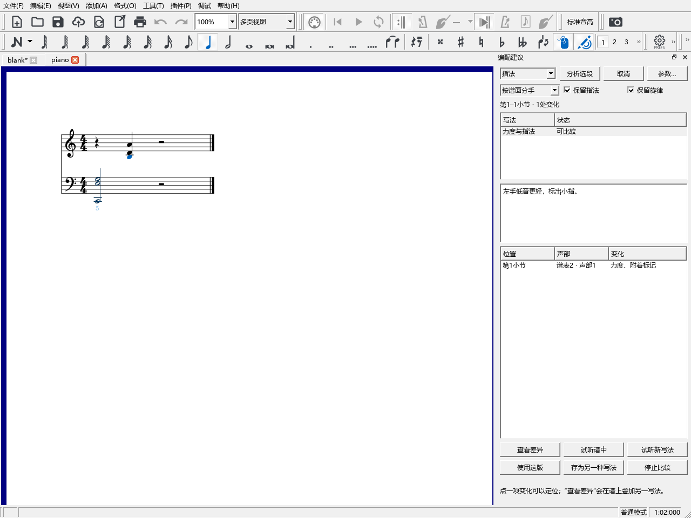

# 在谱中比较和采用 Codex 的编配建议

## 可以用来做什么

选中一段乐谱，向 Codex 说明想保留什么、想改变什么。Codex 可以读取正在编辑的音符、声部、和弦解释和你保存的资料，送回一至三种写法。你在乐谱中看差异、听效果，再采用喜欢的一版。

例如：“保留右手旋律和和声，把这四小节的左手写得疏一些，给我两版比较。”

## 从哪里打开

从“视图 → AI 连接”点“配置 Codex”，再检查连接。完整操作与旧版配置方法见[AI 连接说明](WORKSPACE_063_GUIDE.md)。

“视图 → 编配建议”打开右侧面板。收到新写法后，这个面板也会自动打开，和检视器等工具并列。

## 第一次完整操作

1. 在乐谱中选中要编配的小节和谱表。点选几个零散音时，读取范围采用它们之间的起止位置，界面返回具体范围。
2. 在 Codex 中提出要求，例如上面的“左手疏一些”。正在编辑、尚未保存的内容也会读到。
3. 收到写法后，在“编配建议”选一项。上面显示范围和一句话说明，下面列出音高、节奏、力度或标记的变化位置。
4. 点列表中的位置，乐谱和演奏编辑器会定位到那里。点“查看差异”，淡色显示新写法，正常谱面保留当前写法。
5. 用“试听谱中”和“试听新写法”比较。两者使用相同范围，切换时沿用当前播放位置。试听需要软件的声音设备正常工作。
6. 点“使用这版”采用。`Ctrl+Z` 撤销整次采用，`Ctrl+S` 将新写法和采用记录保存到 MSCZ。
7. 想保留两版继续试写时，点“存为另一种写法”，到“分段试写”切换。保存写法也对应一次撤销。

## 保留旋律、和声与个人设置

第一次默认保留上谱表第1声部的旋律，使用原有和弦音做重排、加倍和节奏变化。主题在左手或另一个声部时，在请求中说明具体位置，例如“保留左手第2声部的旋律”。要改和声时，也把新的和声目标写进要求。

逐音修改会保留这个音的其它设置。重新写整条声部时，会检查总拍数、连音组和两端连线，再准备供比较的谱面。连线端点需要一起调整时，结果会指出相关位置。

## 保存编曲说明和参考资料

可以直接告诉 Codex：“这四小节的主题在左手，请把这个说明记在谱里。”解释、来源、作用范围和材料对应随 MSCZ 保存，保存说明可以撤销。继续补充资料时，原有条目会保留；用同一条资料的编号更新内容。

和弦助手已完成的分析、人工和弦和原曲关联会随读取结果一起提供。和弦助手重新分析后，后续读取使用更新的结果。

## 查看多版与继续修改

几个编配任务可以保留各自的范围和要求。普通读谱查询会继续保留这些任务。

采用一版后，继续在谱面编辑即可。你修改乐谱后，可以让 Codex按现在的内容更新建议；更新后的写法仍通过同一个面板比较。

“停止比较”结束试听并收起差异叠加。候选比较期间，当前乐谱的保存内容和撤销记录保持原状；“使用这版”和“存为另一种写法”分别完成实际保存操作。

版本：0.60.0 · Kumo branch / Freddd13。提交定位：`personal-v0.60.0`。
