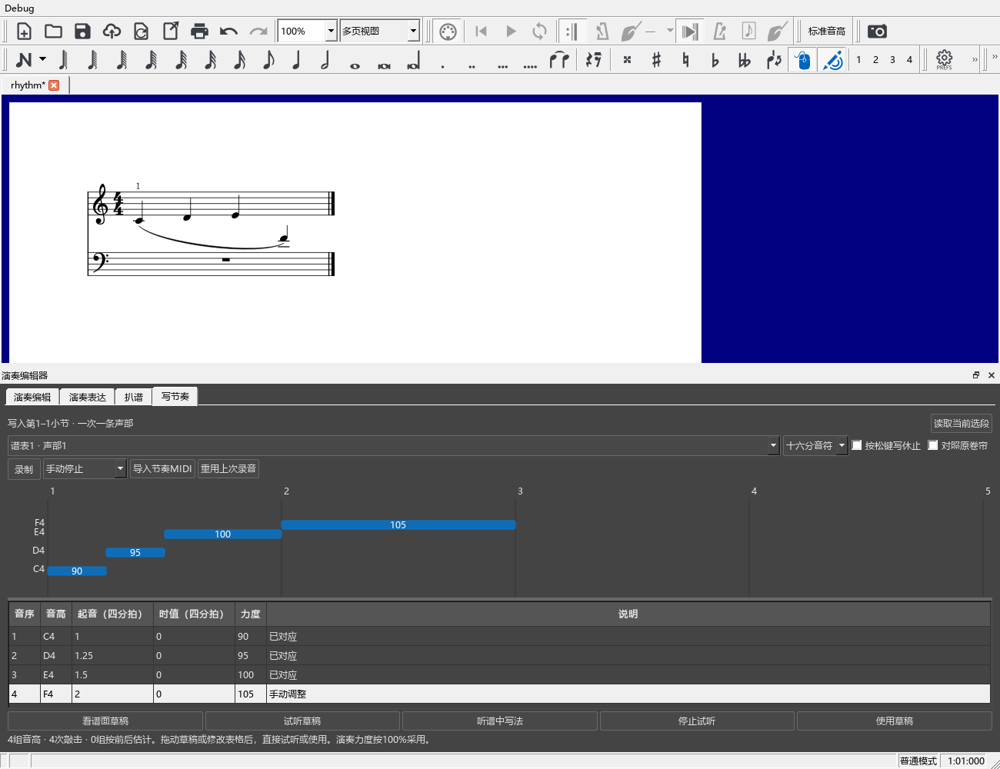

# 给定音高，录入节奏和力度

## 完整操作例子

假设右手已经写了 C、D、E、F 四个音，想换一种节奏：

1. 在谱面选中这几小节，打开演奏编辑器，点 **“写节奏”**。这里读取所选音所在的完整小节，上方会写明将改动第几小节。
2. 选择要处理的谱表、声部。初次采用“十六分音符”细分。
3. 连接 MIDI 键盘，打开软件工具栏的 MIDI 输入，点“录制”。用任意一个琴键敲四下，表达你想要的起音和轻重，再点“停止录制”。
4. 草稿会使用原来的 C、D、E、F，按刚才敲出的节奏排列。第一下放在原来第一个音的位置；它前面的休止保留。
5. 拖动音条改变起音，拖右端改变时值。下面的表格也可以直接改拍数和力度。
6. 点 **“试听草稿”** 听新节奏；点“听谱中写法”比较原来的写法。点“停止试听”继续编辑。
7. 点 **“使用草稿”**，将这条声部写入乐谱。`Ctrl+Z` 一次撤销整次采用，`Ctrl+S` 保存。

## 各区域怎样用

“对照原卷帘”可以展开普通卷帘，核对原来的音高和位置；收起后，草稿和表格获得更多空间。拖动草稿与表格中间的分隔条可调整高度，下次打开会恢复。

上面选择谱表和声部，一次处理一条声部。原来同时起音的和弦是一组音高，敲一下就代表这一组。

“十六分音符／八分音符／八分三连音”决定起音落在哪些位置。细分改变后会重新整理草稿。三连音需要的分组和延音由软件写入。

表格中的起音从选段第1拍计数，单位是四分音符。时值1是四分音符，0.5是八分音符，1/3是八分三连音。时值填0会延续到下一次起音；最后一个音沿用原时值，再用休止补齐选段。

“按松键写休止”开启后，按键到松键之间写音符，松键后的空隙写休止。录制的力度按100%使用，保存为逐音固定力度；表格可进一步调整每个起音组。

## 漏敲、多敲与修改

漏敲的音会按前后位置估计，并在表格写“漏敲，按前后估计”。直接拖到正确位置即可。

多敲的一行显示“多敲，可指定音序”，音序为0。想让它代表某个漏敲音时，填入那个音的编号，并将原来估计行调整为0。同一个音序重复、两个起音重合或录音超出选段时，下面会指出具体问题；改好后就能继续试听和采用。

“读取当前选段”重新取用现在选中的小节和音高，录音可以继续用。乐谱中已有延音跨过选段两端时，将延音的起点和终点一起选进来，便于保持连接。

## 录制结束方式与导入

默认手动停止；也可以选择“弹完音序后停止”或“按秒数停止”。结束后仍进入同一份可修改的草稿。

“导入节奏MIDI”可以使用已有的一段录音。导入音高用于识别敲击次数，草稿采用当前乐谱给定的音高。

录制文件默认保存在本机 `E:/MuseScoreCache/recordings`。采用时，录音音符、来源和对应随MSCZ保存。“重用上次录音”取回这份谱最近采用的录音，便于换一种节奏继续比较。原始MIDI文件也继续保留。

## 保存、撤销与设备设置

采用会保留随音高材料移动的指法、分手、发音标记和圆滑线，并与链接分谱一起更新。音长变化产生的延音按草稿重新连接。

“恢复应用前力度”仍可找回采用前各音的力度，录音采用记录会跟随乐谱保存。带歌词或双音震音的声部需要先整理这些对象，再写节奏；界面会指出要处理的位置。

录制按钮提示设备未就绪时，在“编辑 → 偏好设置 → 输入／输出”选择 MIDI 输入设备，并打开工具栏 MIDI 输入。试听使用软件当前的声音输出。

普通 MuseScore 3.6.2 可以打开并重存采用后的乐谱，音符、力度、指法和连线保留。继续编辑与恢复应用前力度时，使用本分支保存的MSCZ；普通版重存会移除逐音力度恢复记录。分享给其他软件时，另存一份副本即可。

版本：0.62.0 · Kumo branch / Freddd13 · `personal-v0.62.0`。
