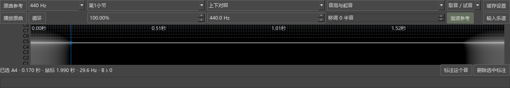
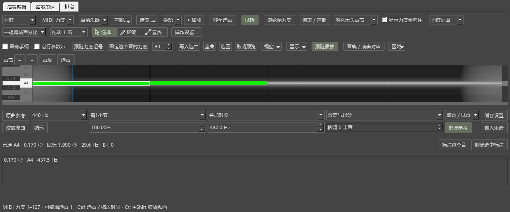

# 用频谱辅助听辨和输入音符

## 从哪里打开

打开乐谱，选择“视图 → 演奏编辑器”，在编辑器上方点“扒谱”。点击这一页的“原曲参考”，打开录音并添加音轨。回到“扒谱”，左上角选择要听的音轨。

原曲参考继续管理多条音频、片段和谱段对应。详细频谱显示当前选中的一条音轨，其它音轨仍可在“音轨／演奏对应”区查看波形。

## 第一次取音并写进谱子

1. 在“原曲参考”打开 WAV、MP3 或 FLAC。已有片段对应时，在扒谱页选择对应片段；也可以选“原曲时间”，直接浏览录音。
2. 点“播放原曲”听这一段。播放速度默认 100%，可在 50%–150% 调整，音高保持原样。
3. 使用“取音／试音”工具，在亮的横线附近点击。下面会显示原曲秒数、频率和音名，并用钢琴音试听。
4. 点“标注这个音”。标注列在下方，跟随乐谱保存。按住 Ctrl 可以选择几个标注，一起输入为和弦。
5. 在乐谱中选定输入位置，选择声部和时值，再点“输入乐谱”。只选一个标注时输入一个音；选多个音高时输入和弦。没有选中标注时使用刚才点击选定的音高；移动鼠标查看其它频率时，选定的音仍然保留。
6. Ctrl+Z 撤销输入，再按一次可撤销刚才添加的标注。保存 MSCZ 后，音符和标注都会保留。

频谱越亮，表示这一频率附近的声音越强。一个钢琴音通常同时出现多条横线：最低的主要横线可能是基音，上面的线可能是它的谐波。打开“谐波参考”，点击可能的基音，参考线可帮助判断这些亮线是否属于同一个音。结合试听确认选音。

## 上下对照与叠加对照

“上下对照”把钢琴卷帘和频谱分别显示；“叠加对照”将频谱放到卷帘后面。有关联的片段按谱中位置对齐，频谱顶部还显示录音的秒数。

叠加时，普通点击用于取音；按住 Alt 可以继续选择、拖动卷帘中的音符。演奏编辑、演奏表达和扒谱分别记住区域高度。拖动分隔条调整大小；扒谱初次打开会收起力度区，给音符和频谱留出空间，可从“区域”重新展开力度区。

## 浏览、放大和循环听辨

- 普通滚轮前后浏览时间；Ctrl+滚轮缩放时间；Shift+滚轮缩放音高范围。
- “手形平移”工具或鼠标中键可以拖动时间轴。
- 使用“选择循环”拖过想反复听的范围，再打开“循环”。拖反方向也可以选择。循环片段至少 0.2 秒。
- “音高与起音”适合一般听辨；“低音更清楚”使用更长的分析窗口；“起音更清楚”更容易观察快速起音的位置。
- “移调”调整对照音名和输入音高。“440 Hz”是 A4 的调律频率，可按录音修改。原始频率与最终选定音名分别保留在标注中。调律和移调随标注保存；之后修改移调时，列表会显示新的输入音名，原记录继续保留。

## 保存、音频位置和缓存

标注随 MSCZ 保存。录音文件由原曲参考保存路径；移动文件后可在原曲参考中重新定位。

“缓存设置”可以选择频谱存放位置、内存和磁盘容量。本机默认放在 `E:/MuseScoreCache/kumo-spectrum-v1`，内存上限 128 MiB，磁盘上限 1 GiB。达到容量后，软件清理这个目录中较早的频谱缓存，再次查看时重新计算。关闭扒谱页后，频谱任务会取消，这一页开始的原曲试听也会停止。原曲试听使用原曲参考的总音量和当前音轨音量。

版本：0.59.0 · Kumo branch / Freddd13。提交定位：`personal-v0.59.0`。
