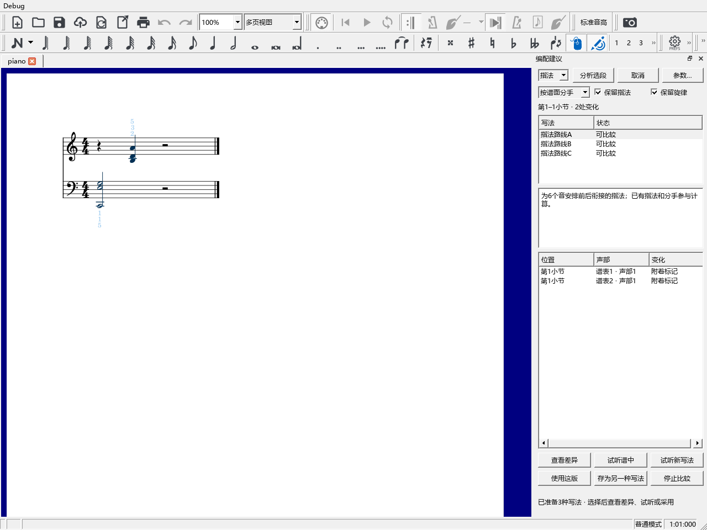

# 指法、换手、配音和对位建议

## 从选段开始

在乐谱中选几小节，打开“视图 → 编配建议”。选择“指法、换手、配音、对位”中的一种，点“分析选段”。读取和计算进度显示在面板下方。准备好后，最多列出三种写法。

例如：选中右手一段音阶，保持“保留指法”勾选，选择“指法”，点“分析选段”。在列表中选一条路线，用“查看差异”看看每个音旁的手指编号，再点“使用这版”。`Ctrl+Z` 一次撤销这次采用，`Ctrl+S` 保存到乐谱。

## 四种建议的作用

- **指法**：一起考虑前后起音、同时按下的音、保持音及黑白键位置，准备少量手指路线。1是拇指，5是小指。“保留指法”让已有编号参与安排，继续保留原文。
- **换手**：比较两只手同时的按键、跨度和手位，寻找可以借另一只手的音。采用后在相关音旁加入分手记号。已有分手说明参与判断。
- **配音**：尝试把伴奏中的个别音升、降一个八度，比较按键跨度和前后衔接，保留原来的和弦构成音。默认“保留旋律”保护上谱表第1声部。
- **对位**：沿着声部检查前后音，尝试用同一组起音中已有的和弦音改善平行、交叉等位置。风格选择与编配检查一致。结果会列出具体改音，适合连同前后小节试听。

“按谱面分手”使用分手标记、编配检查中的本谱声部设置及自动手位建议。选中单手乐句时，可直接改成“选段用右手”或“选段用左手”。

## 参数怎样调

“参数…”可分别设置左右手的舒适跨度、最大跨度及两端白键时的上限，单位为半音。初值沿用大九度、小十度和白键大十度。

下面的“重视程度”改变指法路线的排序。例如提高“移动手位”，会更偏向手位移动较少的路线；提高“黑键拇指”，会更少安排拇指按黑键。个人设置下次打开继续使用。

## 比较、采用和继续编辑

“查看差异”在原谱上显示另一写法。点变化列表定位到相关音。“试听谱中／试听新写法”比较同一段；指法与分手改变主要供手上练习比较，音高和节奏变化可以直接听到。

“使用这版”写入当前乐谱，一次采用一次撤销。“存为另一种写法”把建议放进分段试写，方便以后切换。写入前会在副本里检查，并保留链接分谱和原有演奏设置。

一次选择几小节最方便。超过1024个音时，面板会建议缩小范围。切换乐谱或取消操作会结束当前计算；乐谱改动后重新点“分析选段”即可。

版本：0.61.0 · Kumo branch / Freddd13 · `personal-v0.61.0`。
