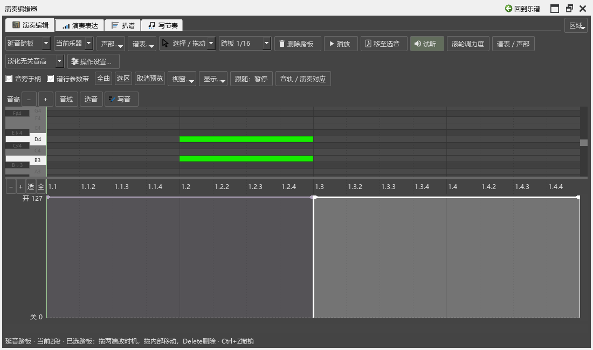
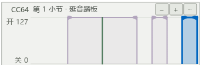

# 踏板编辑检查记录

日期：2026-10-24。对应0.105.0，B5踏板编辑。

## 复现与修改

旧程序中，在相接处右侧拖动后一段的踩下端，后一段仍停在原位。实际窗口复现记录为`P2/out/pedal-105-before-performanceeditor-run.txt`：预期起点1200，实际仍为960。

本批将踩下、抬起分别画为向右、向左的三角，取最近手柄；段内可整体移动。增加画踩下段、画抬起间隙、分开和删除，全部使用原生踏板与乐谱撤销。

检查还发现，只显示钢琴上谱表时，写在下谱表的踏板也被隐藏。现按同一件钢琴共用显示与音符边界；全部相关谱表隐藏后，清除编辑目标。移动时先更新不会越过谱尾的边界，避免链接分谱在中间步骤读到超出范围的位置。

## 实际操作与数据

| 操作 | 核对内容 |
|---|---|
| 相接两端 | 右侧移动后一段起点，左侧移动前段末尾；另一段保持，逐次撤销 |
| 长段画间隙 | 0—1920之间划开600—900，保留0—600和900—1920；CC64实际抬起、再踩下 |
| 补回与分开 | 从480画到1080补回长段；960处分开后，重画仍保留这个明确换踏板点 |
| 移动、微调与取消 | 段内整体移动，Shift+方向键1 tick；Esc恢复原状，取消不增加撤销 |
| 删除与恢复 | 按钮和Delete删除，最后一段可撤销，再画新段；浮窗中Ctrl+Z／Ctrl+Shift+Z |
| 筛选与谱行带 | 只显示上谱表仍改同一钢琴踏板；全部隐藏后清除目标；谱行带拖两端、画间隙，失去激活时归还鼠标 |
| 链接分谱与保存 | 总谱画间隙、补回、分开和撤销后，链接分谱范围一致；实际文件重开保持区间与样式 |
| 其它内容 | 另一件乐器的踏板保持；逐项比较音符起音、松键、音高、通道和力度，实际MIDI一致 |

`pedal-105-filter-performanceeditor-run.txt`完成上述五项流程，加准备、结束共7项通过。发布程序对应的检查再次覆盖原有操作：

| 检查 | 结果 | 输出 |
|---|---|---|
| 本批五组踏板操作，原力度、速度、分谱、选音、鼠标、品牌及写音中断 | 16项流程，加准备、结束共18项通过 | `pedal-105-final-performanceeditor-run.txt` |
| 两侧面板宽度往返，停播后实际点击符号、原曲参考并添加／撤销记号 | 2项流程，加准备、结束共4项通过 | `pedal-105-window-final-pluginhost.txt` |

窗口检查输出保留工作区重建中的绘制警告；具体控件点击、记号添加及撤销都有核对记录，完整工作过程继续列在F。浮窗按键先载入正式快捷键；早期测试宿主没有加载这份配置，相关失败输出继续保留。

## 画面

踏板模式收起力度铅笔、直线及力度拖动灵敏度，保留当前踏板工具。控件按自然宽度排列，选中段使用已有选择色，谱行带使用原生声部选择色；原生谱面选音继续保留。截图检查发现踏板拖动沿用了力度的数字浮标，现已收回；范围用小节、拍位显示。

## 本批之后

本批交付踏板编辑。B5继续SF2／钢琴自动换踏板时机、共用音源与实例保留，以及实际CFX、Pianoteq、SF2和实体MIDI设备检查；后续C、D、E、F顺序保留。

操作说明见[踏板编辑](PEDAL_105_GUIDE.md)，总进度见[完整计划](REWORK_PROGRESS.md)。发布定位：`personal-v0.105.0`。
