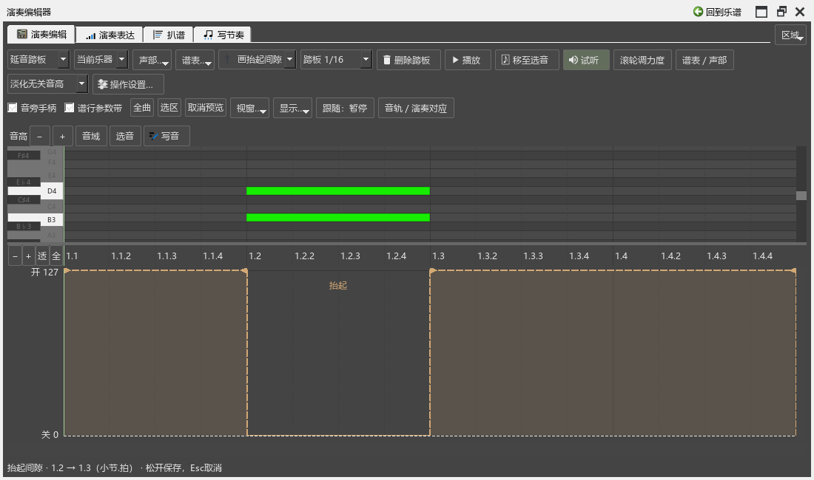

# 在编辑器里修改延音踏板

适用版本：0.105.0。打开“视图 → 演奏编辑器”，在左上角参数选择“延音踏板”。上面的卷帘仍可用于看音符，下面显示这件乐器的踩下段。

## 先把相接的两段分清

- 向右的三角表示踩下，向左的三角表示抬起。
- 两段相接时，在接点左侧拖动前段的抬起端，在右侧拖动后段的踩下端。
- 拖住段内区域可以整体移动，踩住踏板的时间长度保持相同。

例如，想在第3拍换踏板时留一点空隙：把前段抬起端稍向左拖，或把后段踩下端稍向右拖。横线仍对应真实时间，三角的方向用来区分要改哪一端。

## 在长踏板中画出抬起间隙

1. 工具选“画抬起间隙”。
2. 在已有踏板中从开始抬起的位置，水平拖到重新踩下的位置。拖动时会显示两侧保留的踏板和中间的“抬起”提示。
3. 松开保存。按Esc取消这次拖动，Ctrl+Z撤销已经保存的修改。
4. 想补回时，选“画踩下段”，从间隙前拖到间隙后。相交部分会合并；原来明确相接的换踏板点继续保留。

“选择／拖动”中仍可在空白处拖出新的踏板段。“分开”工具在段内点一下，把它分成前后两段，随后可分别调整。

## 精细调整、删除与恢复

- 吸附下拉框提供1/16、1/32、1/64、1/128、自由和音符边界。
- 选中端点后，左右方向键微调这一端；选中段内则移动整段。Shift+方向键每次移动1 tick。
- 选中一段，点“删除踏板”或按Delete删除。删除最后一段后，仍可撤销或重新画。
- 每次拖动、绘制、分开、删除各对应一次撤销。浮动编辑器中同样可以按Ctrl+Z／Ctrl+Shift+Z。

## 谱行带与保存

打开“谱行参数带”后，谱面下方采用相同的方向手柄和当前工具。这里改动后，编辑器和谱上的踏板一起更新。同一件钢琴的上下谱表共用踏板；只显示一个谱表时仍能编辑这件钢琴的踏板。

Ctrl+S保存到乐谱。范围采用原生踏板记号，小节内部的自由时间也会保留。总谱和已建立的链接分谱一起更新。

本页操作改变踏板范围。音符的记谱时值和演奏音长继续保留。SF2／钢琴自动换踏板、共用音源和实例保留按[B5后续安排](SOUND_PEDAL_PLAN.md)继续完成。

