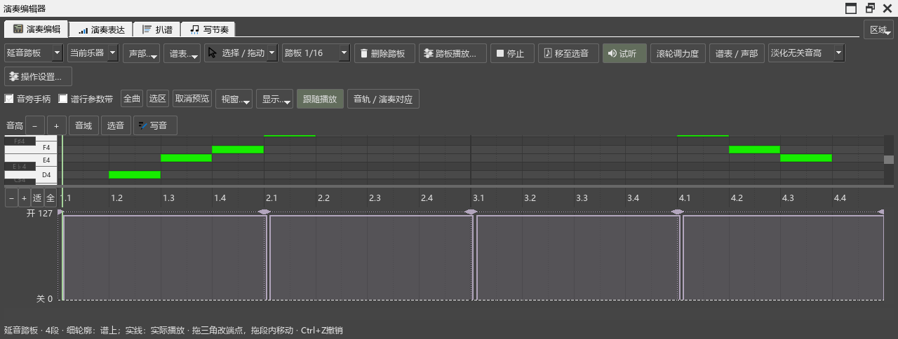

# 钢琴换踏板的操作与声音检查

日期：2026-10-24。版本：0.106.0；源码提交`ea37a2186`（前期设置与时序为`1148b4882`）。属于B5踏板部分；下一项是B5-S共用钢琴与保留已加载音源。

## 界面与操作

- 在演奏编辑器选“延音踏板”，打开“踏板播放…”，给整架乐器保存设置；再单独给一段设置，恢复跟随、撤销、保存MSCZ并重开。链接分谱的实际设置和事件一起核对。
- 实际拖相接端点、段内移动、画间隙、删除、撤销与Esc取消。三角手柄保持谱上位置，细轮廓显示谱上范围，填色实线显示实际踩踏。
- 先播放再打开编辑器，直接读取当前正在播放的踏板；播放中切到链接分谱，停止后补齐全谱。切到原始踏板试听时，图随实际材料更新。

## 事件、导出与连续操作

相接踏板、明确空隙、实际起音偏移、琶音、速度变化、短音群、反复、逐小节准备和完整渲染逐项比较。音符起止、音高、通道和力度保持原值。

检查中发现后面小节的手动CC64没有保护前面的逐小节准备。现改为先读取整架乐器的手动控制来源，分块和完整导出采用同一处理。含连续踏板控制的乐器沿用原控制；同一谱的其它乐器仍可使用钢琴换踏板。

“导出谱上原始踏板”的文件与切换钢琴方式前逐字节一致。松手对比的原／新试听也采用本次选择的踏板，避免图与试听使用不同的版本。

## 三种音源的声音文件

使用本机SF2、Pianoteq 9 VST3及Garritan CFX VST2，分别渲染原有／钢琴方式的三小节独立谱例，共六份WAV。读取实际声音样本，核对有效输出与相同音符事件。

声音材料和每源记录保存在插件仓库`P2/out/pedal-106-audio/`，测试记录为`pedal-106-real-audio-pluginhost.txt`。本轮渲染5项通过（含准备和结束），约28.2秒。

在这组谱例里，换和弦后旧E3、G3及其前几阶谐波的残留，Pianoteq与CFX的钢琴方式低于原有方式；SF2两者接近。测量时窗与数值保存在`spectral-comparison.json`。实际钢琴片段与声卡听感继续在B5／F检查，用来调整个人预设。

## 最终回查

`pedal-106-final-performanceeditor-run.txt`共32项通过、0失败（含准备和结束），约18.7秒。包含原有力度、踏板编辑、原／新试听和完整播放。检查中修正了原始踏板试听的声音设置生命周期，以及编辑器早于声音系统建立时漏接播放通知的问题。

## 性能与后续

160小节的已准备音符按批读取。首次记录的最长批次约2.00ms，单小节约0.03ms；平移、缩放与调整窗口复用已有结果。播放中读取已经准备的事件，图表更新使用非等待式读取。

后续按B5-S共用／独立音源、保留实例、真实设备继续，再到C音乐判断、D记谱、E AI与分享、F完整使用。AI当前路径与原生选段图的计划见[AI读取安排](AI_WORKFLOW_REVIEW_20261024.md)。
