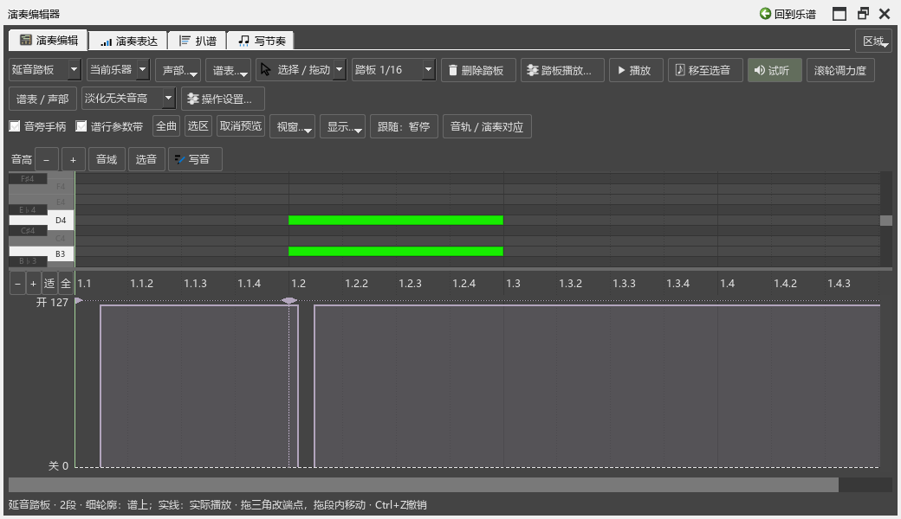

# 给钢琴选择踏板播放方式

这项设置用来调整换踏板时抬起和踩下的时机。SF2可以继续用原有方式；CFX、Pianoteq等钢琴音源可以选择“钢琴换踏板”，让相接的两段踏板之间留出实际抬起的时间。

谱面音长和音符的播放长度照旧。手指持续按住的音仍会发声；踏板负责保持已经松键的声音。

## 第一次使用

1. 打开乐谱和演奏编辑器，在参数选择中选“延音踏板”。
2. 点击“踏板播放…”。
3. “应用于”选择“这架乐器的全部踏板”，方式选择“钢琴换踏板”。同一架钢琴的上下谱表共用这项设置。
4. 先用抬起间隔40ms、音后踩下60ms，点击“保存设置”。
5. 播放有换踏板的位置。回到图中可以看到两层：细轮廓表示谱上范围，实线和填色表示实际踩踏区间。

图上的三角手柄始终对应谱上端点。拖手柄可以改谱上范围；拖段内可以移动整段。鼠标停在这段踏板上，会显示实际踩下、抬起比谱上端点提前或延后多少毫秒。

先播放再打开编辑器，也会读取当前正在播放的踏板。停止播放后，补齐整份谱的显示。较长乐谱准备时会显示进度，平移和缩放继续使用已有结果。

## 各设置的作用

| 设置 | 怎样使用 |
|---|---|
| SF2原有方式 | 沿用原有的踏板时机，适合继续使用熟悉的SF2效果 |
| 钢琴换踏板 | 在相接踏板之间安排抬起间隙，再于实际起音后踩下 |
| 抬起间隔 | 前段实际抬起到后段实际踩下之间的时间 |
| 音后踩下 | 从新一组音的实际起音，到再次踩下踏板的时间 |
| 开始处也在音后踩下 | 独立踏板段的开始也采用音后踩下 |

例如，音后踩下60ms、抬起间隔40ms：新音出现约20ms后抬起，再过40ms踩下。琶音、起音微调和速度变化都会参与时间计算。快速片段中可用时间较短时，实际间隔会随之缩小，图和悬浮说明显示实际结果。

谱上已经画出的踏板空隙继续保留。这架乐器含有手动控制或连续踏板资料时，沿用它已有的控制，界面会写明原因。

## 单独调整某一段

1. 在图中点选一段踏板，再点“踏板播放…”。
2. “应用于”选“选中的踏板段”。
3. 可以为这一段选另一种方式或时间；选“跟随这架乐器”可恢复共同设置。

一次“保存设置”可以用Ctrl+Z撤销。设置随乐谱保存，重新打开后继续使用；链接分谱中的共同设置会同步。

画间隙、分开、删除、重画和端点操作见[踏板编辑](PEDAL_105_GUIDE.md)。

## 导出MIDI

MIDI导出页的“导出谱上原始踏板”控制导出的版本：

- 关闭：采用当前演奏方式，包含已经设置的钢琴换踏板。
- 勾选：采用SF2原有的踏板时机。

“人性化裁剪”与它分别设置。松手对比会读取本次选择的实际踏板，预览和最终文件使用同一份事件。

## 怎样按声音调整

先听原有方式，再切到钢琴方式，从相同位置比较。觉得前一个和弦留下的声音太多，可以适当增加抬起间隔；觉得连贯性变少，可以减小间隔。听新和弦的起音时，再调整“音后踩下”。

每架钢琴都可以保存自己的设置，个别位置用单段设置细调。已写满时值且仍在按键的长音，会继续保持其播放长度。
