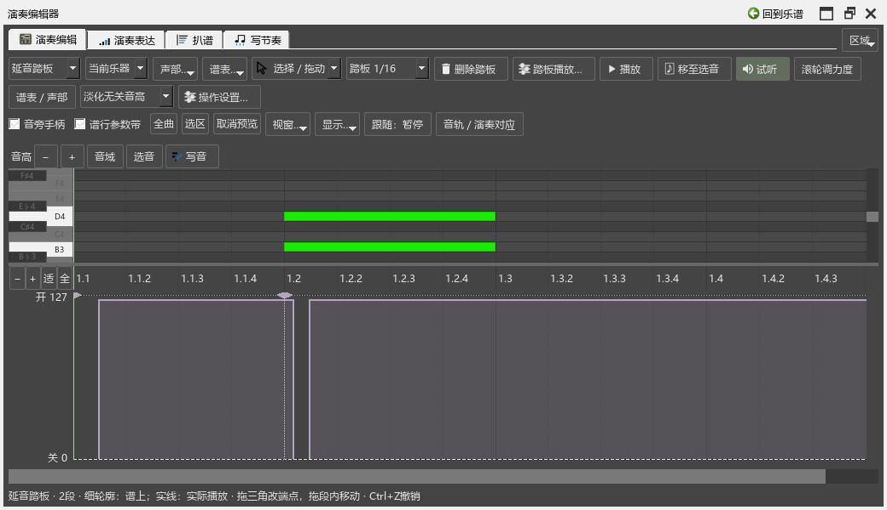
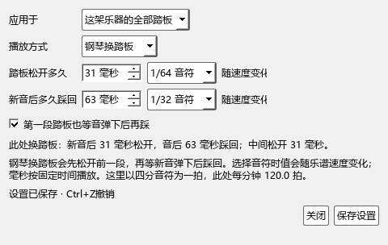

# 给钢琴选择踏板播放方式

这项设置决定换和弦时，踏板松开多久、等新音弹下后多久再踩回。CFX、Pianoteq 等钢琴音源可用“钢琴换踏板”听清换和弦的位置，SF2 可以继续选择“SF2原有方式”。

## 先试一处换踏板

1. 打开“视图 → 演奏编辑器”，参数选“延音踏板”。
2. 点击工具栏的“踏板：SF2…”或“踏板：钢琴…”。
3. “应用于”选“这架乐器的全部踏板”，“播放方式”选“钢琴换踏板”。钢琴的上下谱表共用这项设置。
4. 先保留“踏板松开多久”为 **40 毫秒**、“新音后多久踩回”为 **60 毫秒**。下方例子会写明，此处在新音后约 20 毫秒松开，音后 60 毫秒踩回。
5. 点“保存设置”，从同一处播放比较。图中细轮廓是谱上踏板，实线和填色是实际踩踏的时间。

这两个时间一起决定动作顺序。例如，把松开时间改成 80 毫秒、踩回时间保留 60 毫秒，前一次踏板就会在新音前约 20 毫秒松开。设置窗口里的例子随输入更新。

## 用音符时值设定

每行的下拉框可以选择“按毫秒”，也可以直接选 **1/128、1/64、1/32、1/16、1/8 或 1/4 音符**。旁边显示按该处速度换算的毫秒。

例如，四分音符每分钟 120 拍时，1/64 音符约为 31 毫秒，1/32 音符约为 63 毫秒。可以把“踏板松开多久”选为 1/64、“新音后多久踩回”选为 1/32，保存后试听。

- 选择音符时值，快慢变化时会按当地速度计算松开与踩回的时间。
- 选择毫秒，使用固定时间。旁边的“约 0.08 拍”用四分音符为一拍，帮助估计它与节奏的关系。
- 窗口下方以当前踏板或当前位置的速度举例。实际播放还会跟随起音微调和琶音。

较快的片段中，前后音之间的时间很短，软件会把踏板间隔安排在可用时间内。图中的实际踩踏区间和悬浮说明可以查看具体结果。

## 各项设置

| 设置 | 作用 |
|---|---|
| SF2原有方式 | 按谱上的踏板位置播放，适合继续使用原有 SF2 效果 |
| 钢琴换踏板 | 在相接的两段踏板之间松开，再在新音弹下后踩回 |
| 踏板松开多久 | 从抬脚到再次踩下，两次动作之间的时间 |
| 新音后多久踩回 | 新一组音实际弹下后，等待多久再踩踏板 |
| 第一段踏板也等音弹下后再踩 | 整段开头或独立踏板段的开始也采用音后踩踏板 |

觉得前一个和弦留下的声音太多，可以增加“踏板松开多久”。觉得连接太干，可以缩短它。要调整新和弦起音后的感觉，再改“新音后多久踩回”。

## 调整某一段、保存与恢复

在图中选中一段踏板，再打开设置，“应用于”就可以选择“选中的踏板段”。为这一段设置自己的方式或时间；选“跟随这架乐器”恢复共同设置。

点一次“保存设置”形成一次撤销，Ctrl+Z 恢复上次设置。按正常方式保存 MSCZ，重开后继续使用。链接分谱的共同设置一起更新。

图中的三角手柄对应谱上端点。拖两端改范围，拖内部移动整段。新建、画间隙、分开、删除和恢复见[踏板编辑](PEDAL_105_GUIDE.md)。

手指仍按住的音继续由按键维持。踏板负责保持已经松键的声音。已有手工或连续踏板控制的乐器继续采用这些控制数据。

## 查看播放和导出

先播放再打开编辑器，可以读取当前演奏里的踏板区间。停止后会补齐整份谱的显示；平移和缩放使用已经准备好的资料。

MIDI 导出页的“导出谱上原始踏板”可选择版本。关闭时采用当前演奏设置，包含钢琴换踏板；勾选时使用谱上原有踏板时机。人性化松手处理会读取本次选定的踏板，预览与导出使用同一份结果。
