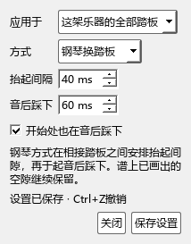

# 钢琴换踏板：本批实现与检查

更新：2026-10-24。当前安装版本仍为0.105.0；以下是0.106.0正在检查的B5改动。

## 操作过程

1. 打开演奏编辑器，参数选择“踏板”。
2. 点击“踏板播放…”。“应用于”可选整架乐器；已经点选一段踏板时，也可单独设置这一段。
3. “SF2原有方式”采用原有踏板事件。“钢琴换踏板”根据实际起音安排抬起与再次踩下。
4. “抬起间隔”设置两次踩踏之间的释放时间；“音后踩下”设置起音到再次踩下的时间。例如音后60ms踩下、抬起40ms，会在起音约20ms后抬起，约60ms后重新踩下。
5. “开始处也在音后踩下”用于一个独立踏板段的开始。谱上明确画出的空隙保留。
6. 点击“保存设置”，一次保存可用Ctrl+Z撤销。设置随乐谱保存；选中踏板可选择“跟随这架乐器”。

MIDI导出页提供“导出谱上原始踏板”。勾选时采用原有踏板时机，关闭时采用当前演奏方式；人性化松手对比使用同一批导出事件。

旧谱沿用原有方式。40ms和60ms是本批声音对照的起始参数，听感检查后再确定预设。每个参数都可调整。

## 实现

- 整架乐器和单段踏板分别保存设置，复制、链接分谱和撤销沿用原生属性。分谱从总谱取得共同设置。
- 时间计算使用已展开的播放时间及实际音符起音。分块准备时读取下一小节的起音，让边界处与完整渲染一致。
- 原始踏板端点保留音乐位置；播放只改变CC64的时机。音符的起音、松键、音高及力度一起核对。
- 有手动或连续CC64的资料保留其控制数据；自动生成事件单独标明来源，供后续分块继续处理。
- 时间计算使用数值区间与起音表，界面和播放准备共用这一计算。播放回调继续消费准备好的事件。

## 当前检查

| 内容 | 状态 |
|---|---|
| 相接踏板、明确间隙、实际起音偏移、短音群压缩 | 已运行通过 |
| 旧方式事件与音符保持、撤销、保存重开 | 已运行通过 |
| 链接分谱与单段覆盖 | 已运行通过 |
| 速度变化、反复和逐小节准备 | 已运行通过 |
| 设置窗口实际点击、尺寸与截图 | 已运行通过 |
| 原有编辑与本批踏板 | 24项通过，记录见`pedal-106-final-performanceeditor-run.txt` |
| CFX、Pianoteq与SF2输出、设备听感 | 接着完成 |
| MIDI导出选择原谱／演奏踏板 | 已通过：原谱踏板文件与原路径逐字节一致，当前演奏文件按新踏板输出；开关实际点击有效 |
| 编辑器显示实际踩踏区间 | 接着完成 |

本批结束后继续B5共用钢琴、保留实例与实体输入，后面按C音乐判断、D记谱、E AI与分享、F完整使用推进。

## 已完成的实际检查

- 最终编译：主程序与演奏编辑器检查程序成功，生成版本0.106.0，保留Kumo branch／Freddd13。
- `pedal-106-final-performanceeditor-run.txt`：24项通过、0失败（含准备和结束），约10.4秒。六项本批检查覆盖时序、保存、分块反复、分谱、窗口和导出，其余为原有操作回查。
- 原谱踏板的MIDI文件与切换方式前的文件逐字节一致；当前演奏方式产生不同的CC64时机。音符起止、音高、通道与力度一致。
- 链接分谱通过真正MSCZ保存和重开；修改可撤销和重做。设置窗口实际点击保存、关闭，已查看截图并修正文字对比度。
- 当前安装仍为0.105.0；这份源码继续完成实际区间显示、音源输出及声音检查后安装。
