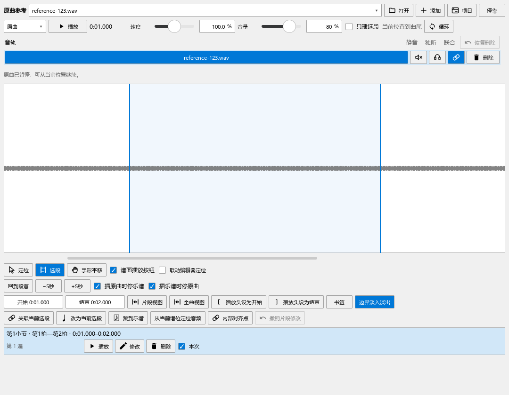
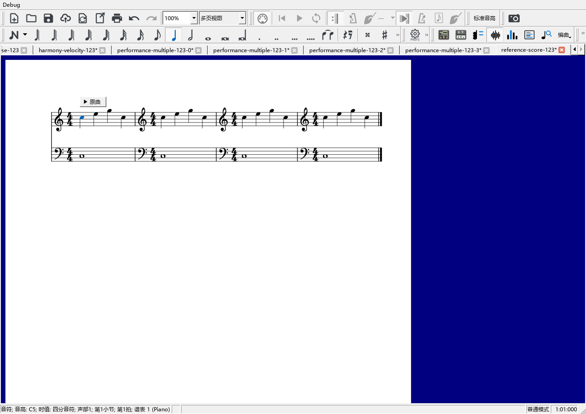

# 关闭和弦助手，方便地听原曲

对应个人版本0.123.0。

## 关闭和弦助手

从“视图”菜单取消“和弦助手”，或点它的工具栏按钮，就会一起关闭摘要、详情、谱面和弦、功能色与范围手柄。主面板右上角的关闭按钮也有相同作用。顶部摘要的“更多”里提供“关闭和弦助手”。

再次打开会恢复原来的字体、颜色和显示选择，并读取当前乐谱。只想收起摘要或详情时，继续用各自的显示开关。

只改力度时，和弦助手会复用已经识别的音高和节奏结果；改音高、节奏、拍号、踏板或调性后重新整理和弦。

## 只想听原曲

1. 从“视图 → 原曲参考”打开播放器，打开或选中一条音轨。
2. 选“定位”，在波形上点要听的位置。拖动后松开，也会把播放头放到那里。
3. 关闭“只播选段”，点“播放”。原曲从当前播放头继续到曲尾；点“暂停”后可从同处继续。
4. 下次直接按默认的 **Ctrl+空格** 控制原曲。快捷键可在首选项的快捷键页修改。

选过片段以后仍能听其它位置。浅色区域显示准备关联或听辨的片段；播放区的文字写明本次会播到哪里。

## 反复听一小段

1. 选“选段”，在波形上划出片段。拖两端的线可微调，下面的“开始／结束”也能改。
2. 打开“只播选段”。点播放会在这一段结束时停下。
3. 再打开“循环”，就会重复这一段。关闭“只播选段”后，循环采用整条音轨。
4. “回到段首”回到所选开始处；“−5秒／+5秒”方便反复听相邻句子。

波形获得焦点时，左右方向键前后移动1秒，Shift加方向键移动5秒。“手形平移”拖动时间轴，中键也可平移；Ctrl+空格随时控制原曲。

旧项目已经启用的片段循环会继续采用原片段。片段、关联及每条音轨的播放设置随乐谱保存。

## 对比原曲与乐谱

波形下方直接提供两个选项：

- **播原曲时停乐谱**：按Ctrl+空格或点原曲播放，乐谱随之停止。
- **播乐谱时停原曲**：回到乐谱按空格，原曲随之暂停。

它们适合交替听原曲和自己的编配。选择“一起播放”后，两者按关联同时播放；下拉框继续提供开头对齐、音频跟随乐谱、乐谱跟随音频三种方式。

## 在谱面播放关联片段

先在乐谱选好音符或休止范围，在波形选好录音片段，再点“关联当前选段”。关联行会列出小节、拍位和音频时间，能直接播放、修改、删除或撤销。

勾选波形下的 **“谱面播放按钮”**，关联开始处就出现“原曲”小按钮。点一下听这条关联，按钮变为“停止”；再点即可停止。它采用关联中的音频片段。同一位置有多条关联时，点击后可选择要听的音轨与片段。

关掉“谱面播放按钮”可收起这些入口，关联继续保留。播放器可悬浮，也能单独关闭；再次打开会恢复已有资料。

## 本轮性能检查

已修复关闭后仍分析、改力度后重复识别和弦，以及铅笔起笔误缩小选音的操作。连续多谱的测量与仍在追查的卡顿见[检查记录](PERFORMANCE_REFERENCE_123_CHECKS.md)。后续任务按[完整进度](REWORK_PROGRESS.md)继续。
