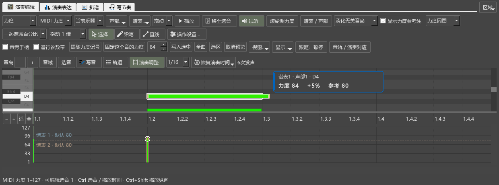

# 0.161 实际起音与松键检查

本批完成N5谱面轨的演奏起止；N4临时MIDI和写谱草稿继续使用。独立测试谱、Windows原生窗口、实际演奏事件及保存文件均已核对。

## 实际操作

- 开启演奏调整后，实心条显示真实按键，原谱轮廓保持。真实鼠标移动主体、拖松键点、Esc取消、选音恢复均通过。
- 两个选中音一起移动，相对距离保持，一次拖动一次撤销。窗口失焦时结束已拖出的修改，归还鼠标；随后仍能点击、恢复和关闭工具。
- 指向移动、拉长后的实际音符滚轮调力度，更新正确的音。力度改变后演奏事件缓存继续复用，发声条与数量保持可用。
- 原生普通音、同小节与跨小节延音、倚音、琶音和颤音的起音／松键偏移与输出一致；原NoteEvent、Auto/User模式和记谱时值保持。
- 链接总谱与分谱的调整一同撤销、重做。保存MSCZ后重开，偏移及真实演奏结果一致；音符复制携带调整。
- 导出的MIDI重新读取，改动后的起止与原生事件一致。发声次数不符的旧调整保留并显示音型变化提示，可恢复后重调。
- 较大提前起音扩展原生播放准备，连续播放会提前读到对应事件。普通谱的空数据路径保持原处理。

## 已有操作回查

多轨实际输出、导入／录制／草稿采用、原曲对齐、独立与随谱播放、Home、辅助资料撤销版本、长按力度和P键盘通过。原生编辑器的多音滚轮、手势中断、力度保存、mf/p分别换算、链接分谱、踏板、选音与筛选继续通过。

复制已有工作区的60项设置首次打开，卷帘328像素、参数区201像素均可见，布局后高度保持。截图保留原配色，控件按实际宽度排列。

原生窗口整组17项通过（含初始化和结束）；原编辑器整组15项通过，旧工作区3项通过。具体过程保存在本批日志中。

## 完整程序与普通版

- 0.161普通MIDI与0.160逐字节相同，均181字节；PDF正常导出。
- 官方MuseScore3.6.2实际打开并重存测试谱，6个音的音高、时值及谱面内容保持。本分支重新打开并导出MIDI、PDF成功。
- 官方版重存会移除逐音演奏时间资料；本分支原稿保留这组资料，导出MIDI携带实际演奏。

程序SHA-256：`37fefb4c3d64ac18011f30d6cadc3f7750e0af5f0b7bbb9cbb0b7dfa618c049f`。发布定位：`personal-v0.161.0`。当前准备更新原安装目录，安装结果随后记入本页。

接着处理N6频谱固定块与缩放复用、键盘／谐波和MIDI叠加，然后N7关联控件、N8动态乐谱。实体键盘与演奏者听感按用户安排补查。
