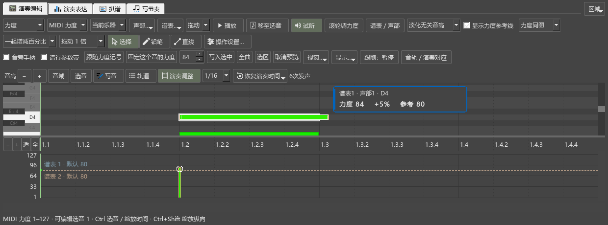

# 在卷帘中调整实际起音和松键

这个工具适合调整演奏细节：让一组音稍早进入、把踏板下的低音提前松开，或改变颤音中某一次发声的长度。谱面上的音符和时值保持原来的写法。

## 打开和第一次调整

1. 打开乐谱，进入“演奏编辑器”的“演奏编辑”。如果已打开MIDI轨道列表，先选“乐谱”。
2. 在钢琴卷帘上方开启“演奏调整”。读取结束后，旁边显示发声次数。
3. 停止播放，放大到容易拖动音符的程度。
4. 拖音符主体：起音和松键一起移动。拖左端：只改起音。拖右端：只改松键。
5. 按空格试听。Ctrl+Z撤销刚才的一次拖动，Ctrl+Y重做。

“演奏调整”首次关闭。关掉它即可继续原来的选音操作；“写音”用于改变记谱，两种工具各自有清楚的开关。

## 图中怎样分辨

- **实心条**是实际按下和松开的时间。
- **细轮廓**保留谱面写的位置和音长，可以看出自己移动了多少。
- 调整过的实心条两端有强调线，选中的音沿用当前主题的选择颜色。
- 延音线连接的音按一次实际按键显示。颤音等多次发声分别显示，可单独调整。

指向音符可查看音名、谱表、声部以及实际起止位置。已有力度区继续用于调力度。

## 吸附、多选和取消

“1/16”等选择决定拖动时对齐到的细分。选择“自由”，或拖动时按住Alt，可精细调整到1 tick。每四分音符含480 tick。

在谱面或卷帘中先选多个音，再拖其中一个，这些音一起调整，并保留原有的相互距离。一个音中的多次发声可以分别拖动。

拖动中按Esc恢复这次拖动前的位置。一次完成的拖动对应一次撤销。切换窗口或开始播放时，已拖出的修改及时结束，鼠标交回当前窗口。

## 恢复原来的演奏时间

开启“演奏调整”后，点击“恢复演奏时间”：

- **选中音**：恢复当前选中的音；延音链恢复实际发声的起点。
- **当前选段**：恢复谱面时间选区中的音。
- **全谱**：恢复当前乐谱的全部演奏起止调整。

恢复也可撤销。原来由倚音、琶音、延音、发音符号和自定义演奏事件产生的时间安排会重新生效。

## 保存、试听和导出

像平时一样保存MSCZ，重开后继续调整。播放、演奏查询、试听及MIDI导出使用同一份演奏结果。音符复制和链接分谱一同携带这些调整。

需要在官方3.6.2中继续编辑时，另留一份本分支MSCZ作为演奏原稿；3.6.2重新保存会保留谱面，并移除这组演奏时间资料。分享实际演奏效果可导出MIDI。

音型改变后，某些音原有的发声次数或音高可能变化。工具旁会显示“几处音型已改变”；选中相关音，恢复演奏时间后再拖动即可。

本工具调整的是谱面轨的演奏。导入的外部MIDI和临时轨已有独立的拖动、改长度与保存操作，见[MIDI轨道](MIDI_TRACKS_160_GUIDE.md)。

发布定位：`personal-v0.161.0`。
