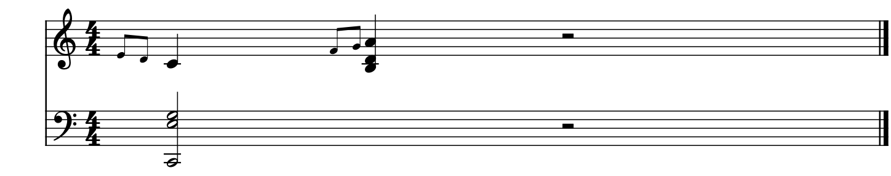

# 0.159 操作、混响和上游检查

检查日期：2026-11-07。Windows x64，Qt 5.15.2；沿用E盘构建及独立运行目录。

## 操作和保存

| 操作 | 实际结果 |
|---|---|
| 在操作设置中选Alt+Q，连续按住并接收自动重复按键 | 数值持续显示；无关Ctrl松键保持显示，真实松开250ms后恢复 |
| P键盘按下后切换窗口，再次点击 | 发出松键，归还鼠标，下一次点击有效；停止播放后恢复原颜色 |
| 前、后倚音分别增加间距 | 实际位置改变，后倚音之间距离增加；撤销、重做和MSCZ重开保持数值 |
| 选段试听中先跳到后面，再在编辑器按Home | 保留候选效果并回到选段起点，重新包含此前的音符 |
| 普通窗口按键、播放中连续滚轮调整 | 现有检查通过，24次滚轮事件最慢5.45ms |
| 上游MusicXML小节反复导出 | 生成文件与上游参考文件SHA-256完全相同 |

倚音谱例保留前后两组，使用原生谱图检查音头、符杠及主音位置：

## Kawai SF2混响

读取实际的Kawai ES100 Concert Grand SF2，分别从普通Fluid和独立SF2音源路径输出。两条路径均测量干声与混响发送，再通过原生Zita1生成声音。

| CC91 | 发送／干声能量比 | 预期 |
|---|---|---|
| 0 | 0 | 0 |
| 40 | 0.0976563 | (40/128)² |
| 127 | 0.984436 | (127/128)² |

相同音符在三档下产生不同尾音，两条路径的输出均为有限值。声音文件留在本地`P2/out/repair-159`中的`kawai-cc91-*.wav`和`kawai-rack-cc91-*.wav`，供当前设备试听。独立SF2检查覆盖其发送和Rack输出，厂商VST效果窗口的操作另沿用已有检查。

新测试同时发现并修正发送量重复缩小32768倍的问题。默认合成器保存的是两个“无效果”，需按说明在F11选择Zita1后调整各乐器混响量。

## 已有播放及效果

普通循环与选段循环、反复中改速、参考时钟下改速、共用钢琴效果导出及两种音源运行方式的尾音检查通过。循环输出没有超过声音块的处理期限；共用音源静音导出为0，打开后有正常声音。

本批新检查及相关回查合计18个具体情景，分别运行于原生插件宿主、演奏编辑器与MusicXML检查程序。窗口检查使用Windows绘制；离屏绘制无法覆盖某个滚轮取点情景，因此该项采用实际Windows窗口复查。

本批完成N1、N2及N3适配。N4多轨MIDI、N5卷帘演奏调整、N6频谱、N7关联控件和N8动态乐谱继续按批准顺序实施。实体MIDI键盘及实际音乐的连续听感仍保留在后续验收中。
