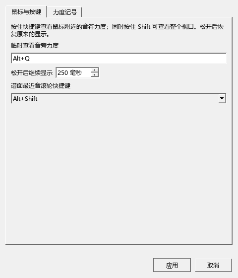

# 长按力度、Home、倚音间距与混响

适用版本0.159.0 · Kumo branch / Freddd13。

## 按住查看力度

在谱面或演奏编辑器按住你设置的快捷键（例如Alt+Q），力度数值会一直显示。再按Shift可查看整个视口，松开Shift恢复附近音符。

打开演奏编辑器的“操作设置…” → “鼠标与按键”，可修改快捷键及“松开后继续显示”。默认立即恢复，也能保留若干毫秒；点击“应用”保存。这个设置只影响显示。

## 播放中按Home

- 普通乐谱播放：回到全谱第一遍开头继续。
- 开启循环：回到循环起点继续。
- 演奏表达等选段试听：回到当前试听段开头，保留正在比较的效果。
- 原曲与乐谱一起播放：按当前关联的起点重新对齐播放。

谱面和编辑器共用定位。已经准备的延音、踏板用于接好起点的声音，画面和发声从实际目标位置开始。

## 调整倚音间距

1. 选中一个倚音，打开检视器。
2. 调整“倚音间额外间距”，改变这一组倚音相互之间的距离。
3. 调整“与主音额外间距”，改变倚音组与主音的距离。
4. 数值以谱间为单位，0沿用原排法；正数增加距离，负数收紧。
5. 重置可回到原排法；Ctrl+Z撤销，保存后重开继续使用。

同组倚音共用这些设置，多选可以一起调整。播放起音和记谱时值继续采用原来的设置。

## 让Kawai等SF2的混响滑块起作用

混音器中的“混响”决定这件乐器送入混响器的量；合成器决定使用哪种混响及空间、尾音和混合比例。

1. 按F11打开合成器。在效果A或效果B中选择Zita1。
2. 播放一段钢琴，在合成器中调整空间和混合比例，先听清整体混响。
3. 按F10打开混音器，选择钢琴，调整“混响”。低值更干，高值混响更明显。
4. 可在混响滑块或数值框上右键，直接“打开合成器混响设置”。
5. 保存乐谱，保留这份谱的合成器效果与乐器发送量。需要作为新谱的常用声音时，再使用合成器原有的保存默认设置操作。

你的默认合成器资料中，效果A和B均为“无效果”，所以新谱最初没有开启混响。某首谱可以保存自己的Zita1设置，打开后便会听到不同的空间效果。调滑块时会明确提示当前是否已启用混响。

本轮还修正了SF2的绝对路径读取。指定音色库文件时会优先读取这个实际文件；旧谱中保存的音色库名称仍按原有音色库目录查找。

## 本轮说明与后续工作

- [AI连接的实现、44项工具与完整操作](AI_CONNECTION_IMPLEMENTATION_159.md)
- [个人开发以来的57项上游更新](UPSTREAM_159_REPORT.md)
- [当前进度与后续完整计划](REWORK_PROGRESS.md)

多轨MIDI、卷帘演奏调整、频谱、原曲关联控件及动态乐谱按本轮已批准计划逐批继续。[本批检查记录](PLAYBACK_159_CHECKS.md)包括实际操作、倚音谱图和Kawai发送量。
