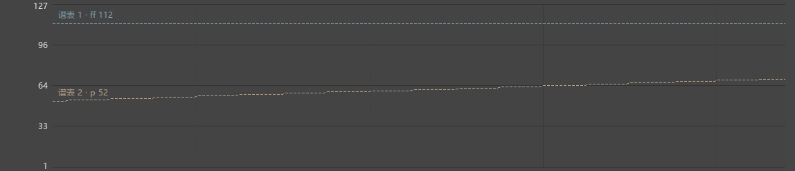

# 播放与力度参考线

0.125继续优化播放时的力度显示。演奏编辑器的“显示力度参考线”仍显示各谱表由p、mf、渐强渐弱等给出的力度；播放光标经过时复用已画好的线条和说明。

## 使用

1. 打开“演奏编辑器”，在“演奏编辑”页选择“力度”。
2. 勾选“显示力度参考线”，可以同时看到右手mf、左手p等各自的参考值。
3. 播放、滚动或缩放，继续按原来的方式选音和改力度。改变力度记号、渐强渐弱、谱表筛选或显示范围后，参考线随之更新。

“滚轮调力度”继续按指向的音修改，一轮滚动合并为一次撤销。播放中的修改先显示预览，停止后写入乐谱。

多谱音源与停播换谱见[操作说明](MULTISCORE_AUDIO_GUIDE.md)。和弦整体关闭、原曲普通播放与选段循环见[操作说明](PERFORMANCE_REFERENCE_123_GUIDE.md)。

本轮真实谱的连续播放、滚轮和缩放结果见[检查记录](PLAYBACK_GUI_125_CHECKS.md)。播放越来越卡的问题继续列在R1-C优先追查，完整顺序见[进度](REWORK_PROGRESS.md)。

图中右手ff的参考值为112，左手p在渐强中逐渐提高；休止处仍能查看两条线。

