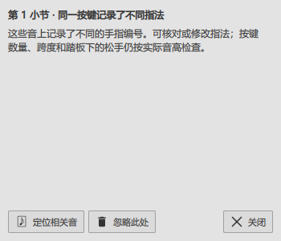
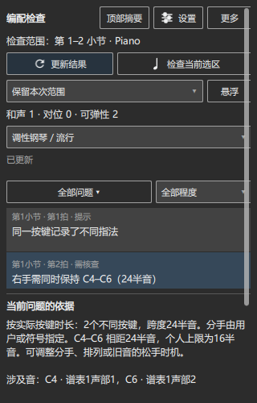

# F-W144：默认绘制与谱旁提示

检查日期：2026-10-30。当前安装0.154.0；正式程序和Qt组件保持原值。

## 实际原因

默认绘制检查中，主面板已经绘出。原操作在弹出“编配提示”后立即截图，仍会以同样调用栈中断：QQuickWindow::grabWindow → QSGThreadedRenderLoop::grab。

分别记录窗口状态后确认：刚执行show时，visible为true，isExposed和isSceneGraphInitialized均为false。测试只检查visible，随后立即进入Qt截图；此时Qt尚未登记该窗口的绘制线程。Qt5.15.2在这个位置只用Q_ASSERT检查，发布构建继续访问空对象。

现在测试先等待窗口实际显示及首帧，再取图。三个连续流程都从true／false／false变为true／true／true，并收到首帧。

桌面状态的记录也已更正：Windows查询返回Default，随后实际桌面画面仍是锁屏。这个名称不足以说明桌面已经解锁。本项确认的是测试取图时序与默认绘制结果；CFX厂商窗口的真实鼠标操作等待解锁后继续。

Qt截图接口及窗口显示状态见[Qt官方说明](https://doc.qt.io/archives/qt-5.15/qquickwindow.html#grabWindow)。

## 实际操作

- 默认绘制完成更新结果、保留范围、类别筛选、定位与谱面提示。
- 打开谱旁说明，核对指法原因、相关音及窗口位于目标音外侧，实际点击“关闭”。
- 修改音高后更新提示，撤销恢复；切换暗色主题，缩小面板并滚动，打开和关闭左右手设置，Esc收起设置。
- 首轮3项通过；同一进程完整重复三次5项通过，耗时24.85秒，窗口截图均已实际查看。

原始记录：插件仓库P2/out/fw144-current154-pluginhost.txt、fw144-ready-default-pluginhost.txt及fw144-repeat-default-pluginhost.txt。第一份保留修复前的崩溃，后两份保留窗口就绪状态及实际操作结果。

## 交付与后续

本次修正测试的窗口就绪条件，正式软件继续使用已经安装的0.154和同一份Qt5Quick.dll。用户说明补充谱旁操作及当前截图，F-W144完成。

接着检查CFX厂商窗口的实际按钮和焦点。E2-W2等待当前Codex重新连接；E4上游范围、实体MIDI、声卡听感和Synthesia分手颜色继续按[完整进度](REWORK_PROGRESS.md)安排。
