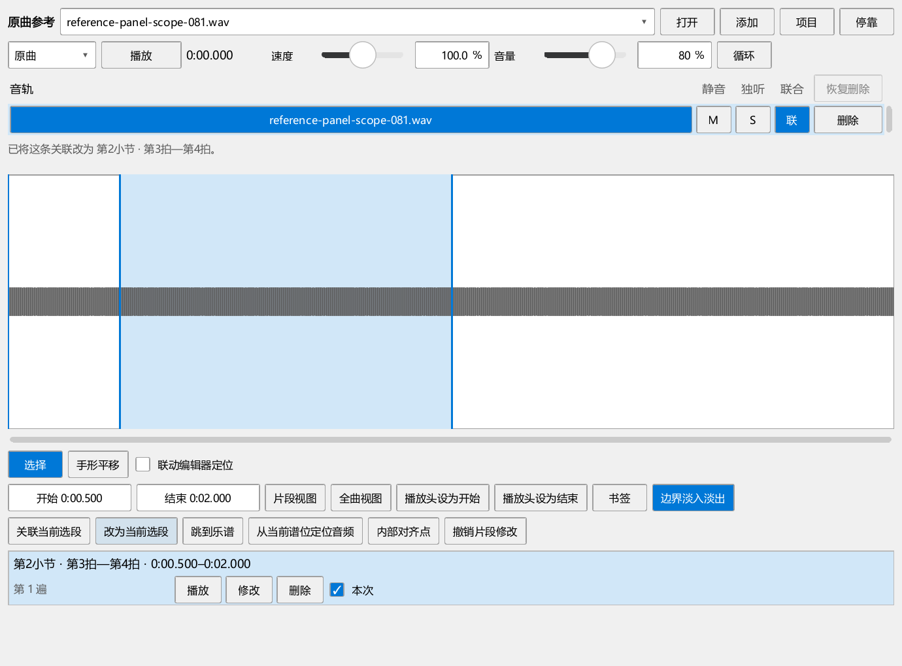

# 原曲关联、选段播放与保存检查

对应0.81.0，使用独立测试谱与合成音频，材料和测试临时目录放在E盘。

## 已复现的问题

- 第2小节第2拍作为起点，原曲500—4500毫秒关联到两小节。旧版乐谱先从0 tick开始，第一音为C4，原曲等了2.5秒进入。记录：`P2/out/reference-081-before-performanceeditor-run.txt`。
- 在另一谱表的长延音中间起播，只从当前段的确切起音查找延音，遗漏了其它声部在这一拍仍持续的音。所需前文误记为3840 tick，实际延音从0开始。记录：`reference-081-held-before-performanceeditor-run.txt`。
- 面板用小节范围建立关联。用户选2400—3840 tick，关联变成1920—3840。记录：`reference-081-ui-range-before-performanceeditor-run.txt`。
- 播放中改音量后，停播没有补存；检查中的关联记录尚未进入乐谱。记录：`reference-081-ui-before-performanceeditor-run.txt`。

## 这组检查实际做了什么

### 八条音轨

每条音轨使用一种不同的测试音高，经媒体解码、保调处理和真实的乐谱混音回调输出。读取输出声音中的八个频率，核对每条轨道都有声音；记录乐谱首音和原曲首个输出。

三种播放方式各重复两次，另查联合循环、准备过程中取消以及停止。内部对齐点把一段分成不同快慢，核对保调和输出范围。

### 延音、踏板与普通播放

使用两个谱表：上方一个C4通过四小节延音线延续，下方有连续四分音符。从第4小节第2拍开始，核对持续的C4、当前低音、踏板留声和松踏板。随后回到普通播放，检查延音链只起音一次。

踏板在实际MIDI事件的边界检查。MuseScore在谱面线条终点与CC64之间有短偏移，检查谱通过渲染结果确定真实边界。起点恰好抬踏板时，已由踏板保持、手指已松开的音按实际控制事件处理。

持续音恢复供联合播放和演奏表达共用。规则对照[MIDI控制器说明](https://midi.org/midi-1-0-control-change-messages)与本项目Fluid音源中的踏板、控制器处理；原始事件保持原状。

### 面板与保存

在实际浮动面板点击建立关联、更新范围和播放；分别使用连续选区、单音和休止符。核对显示名称与保存拍位。播放中改音量，停播后读取乐谱记录；关闭正在播放的面板后再核对记录，压缩保存并重新读取。

## 结果

| 检查 | 实际结果 | 日志 |
| --- | --- | --- |
| 片段起点、八轨混音、延音与踏板、循环和已有播放 | 13项操作通过，含准备与结束共15项 | `reference-081-final-run-performanceeditor-run.txt` |
| 正常主窗口保存、悬浮面板保存、八轨关联计划 | 3项操作通过，含准备与结束共5项 | `reference-081-native-window-nativeui-run.txt` |
| 录制结束后的对应、试听与采用 | 1项操作通过，含准备与结束共3项 | `reference-081-recording-p1native-run.txt` |
| 原有选音与播放显示、版本、扩展开关及独立工具窗口 | 5项操作通过，含准备与结束共7项 | `reference-081-tools-pluginhost.txt` |
| 选段频谱、卷帘缩放、平移、整条录音和内部对齐点 | 2项操作通过，含准备与结束共4项 | `reference-081-spectrum-selection-pluginhost.txt` |
| 150%显示缩放下建立、修改关联和关闭保存 | 2项操作通过，含准备与结束共4项 | `reference-081-dpi150-performanceeditor-run.txt` |

日志均保存在插件仓库的`P2/out`。三种联合方式各两次，首个乐谱位置均为2400 tick，首音为A4，首个原曲输出均在0.000秒；八个测试频率均从输出中检出。保调超出范围时，提示显示所需速度；本例明确显示300.0%。

另用Python直接打开保存的MSCZ，读取`kumo.reference`：总音量为0.42，一条音轨，谱段0—1920 tick，录音500—2500毫秒。记录保存在`reference-081-file-readback.json`。

检查中修正了一处旧测试的选区：原先点中四分休止符，却按整小节播放核对；现明确框选整小节，继续检查原来的播放用途。另按实际渲染的CC64核对抬踏板边界。

本批混音读取数字音频输出，声卡听感与真实键盘操作继续按[完整使用检查表](USABILITY_REWORK_20261019.md)进行。正常主窗口首次创建工作区仍有Qt绘图警告，继续查明具体调用位置。
