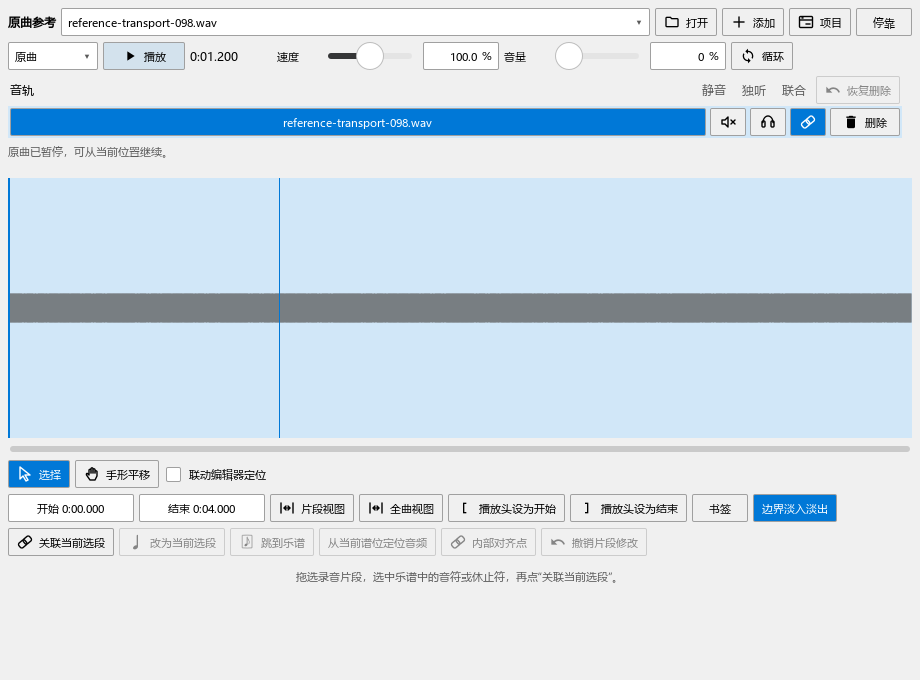
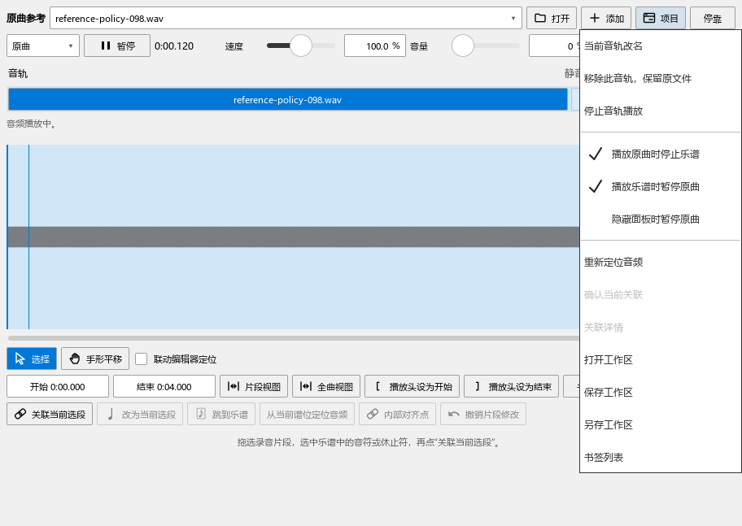

# 原曲播放入口与暂停位置检查

对应0.98.0，B2继续进行。操作见[原曲播放和快捷键](REFERENCE_098_GUIDE.md)，完整安排见[当前进度](REWORK_PROGRESS.md)。

## 实际复现和修改

1. 用原曲面板播放，再调用原曲快捷操作，旧代码同时启动一份单曲播放器和一份项目播放器；实际读到两者均在播放。之后按同一键，会只控制其中一份。记录：`reference-098-before-performanceeditor-run.txt`。
2. 原曲快捷操作原先跳过所选轨的静音；已在同一实际面板复现。现在各入口共用项目播放器，原单曲对象负责文件、波形与定位资料。
3. 浮动播放器的窗口已激活，但点空白处没有具体输入控件时，原生按键过滤要求控件焦点存在，导致空格被跳过。现覆盖这种空白焦点，同时保留文字输入。
4. 原有快捷操作没有默认Ctrl+空格。现补默认资源与旧设置升级：自选F8、主动取消绑定、Ctrl+空格已由另一动作占用，以及先按Ctrl+空格再按F8的连续快捷键分别检查。
5. 说明曾提及原曲与乐谱相互停止的设置，实际菜单没有对应开关。现提供两个独立选项，默认关闭；普通原曲暂停保留正常乐谱播放，联合停止一起结束两边。

## 从打开到暂停继续

在920×680浮动播放器中，实际点击播放、暂停和静音，用同一原曲快捷动作交叉控制，再通过窗口按空格和Ctrl+空格。静音时保持停止，解除后可播放。原曲模式显示当前对象；快捷键切回原曲对象。

定位到1.2秒后开始，暂停时读取实际输出位置；再次开始从保留位置继续。循环范围0.5—1.5秒、速度125%，从1.2秒进入，第一遍走到末尾后回到0.5秒；关闭循环后播放至片段结束。源时间由实际输出帧换算。

## 与乐谱配合

通过实际项目菜单分别勾选两个开关：

- 两项关闭时，原曲和普通乐谱各自播放；暂停原曲保留乐谱。
- 播放原曲时停止乐谱，核对Seq停止并恢复编辑状态。
- 播放乐谱时暂停原曲，核对乐谱继续、录音暂停及源位置。
- 两项开启时，选择一起播放仍保持两边运行，按钮可同时停止。停止后源播放头保留在已经听到的位置。
- 选择乐谱第2拍，点击“从当前谱位定位音频”，原曲从关联的250毫秒处继续；开启隐藏时暂停，实际关闭面板、重新显示，播放位置继续可用。

## 回查与当前范围

`reference-098-final2-performanceeditor-run.txt`记录14项流程，加准备和结束共16项通过，包含新播放操作、默认键及旧配置、独立面板空格、三种联合方式反复起停、八条可辨认测试音的混音、延音与踏板、精确选段与保存，以及演奏录制和同拍位试听。

最终快捷键补查为`reference-098-release-performanceeditor-run.txt`：5项流程加准备、结束共7项通过，含实际浮动窗口Ctrl+空格、空白处空格、旧配置、连续按键占用及播放设置。

`reference-098-tools-pluginhost.txt`：工作视图宽度、停播后符号与原曲参考点击、安装版本与关于标识，3项加准备、结束共5项通过。

当前播放检查结合Qt实际输出时钟与原生混音回调，八轨使用不同测试频率。实体键盘、声卡听感和真实音乐的完整比较继续按B5／F核对。

B2接着检查逐轨增删与切换、修改已有片段、内部对齐点、多个关联和保存恢复，再按B3—F推进。现有布局、音轨数据和个人开关保留；这批围绕播放控制调整。

## 发布

版本0.98.0，发布定位personal-v0.98.0。程序沿用`E:\programming\funcodes\muse3_dev\MuseScore\msvc.install_repair_current_x64\bin\MuseScore3Evo.exe`，媒体模块与程序一起更新，之前版本与模块备份留在E盘。安装后逐一核对程序、页面和媒体模块，kumo.ini保持原值。
