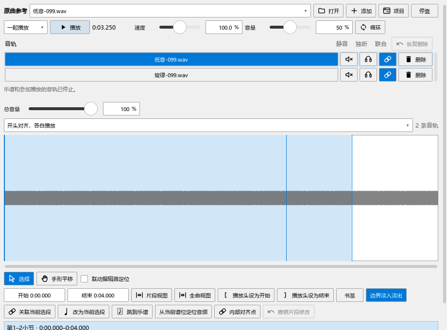
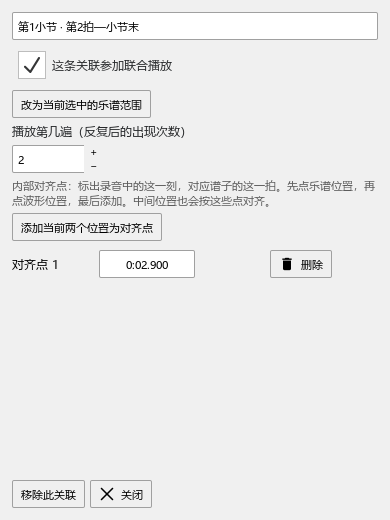
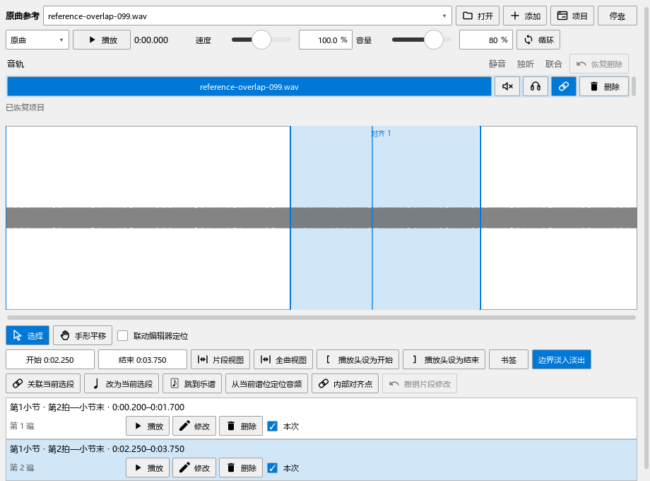
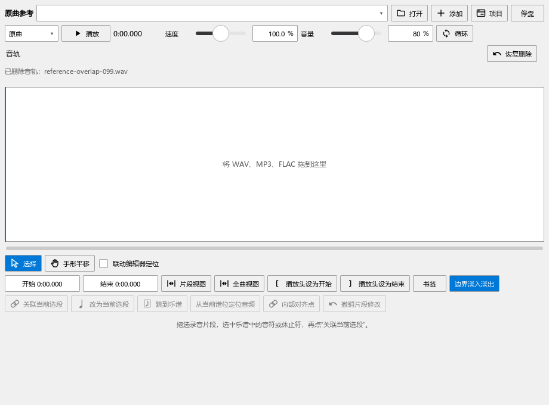

# 多轨、片段关联与恢复检查

对应0.99.0，日常步骤见[多轨比较与修改片段](REFERENCE_099_GUIDE.md)。

## 本批找到的问题

- 0.98播放时禁用了逐轨静音、独听和音量。原实现先把各轨音量合进多秒缓冲，直接修改解码端会延后听到变化。现各轨保留有界缓冲，在输出时读取当前音量，并以短渐变衔接。
- 同一谱段再建立关联时，旧、新两条同时参加本次播放，计划读取报重叠。两条记录都保留，新建的用于本次播放；改范围、遍次和手动选择使用同样的规则，支持撤销。
- 删掉最后一条音轨时，恢复按钮随音轨区一起隐藏。恢复音轨后，异步读取又会清空刚恢复的关联。空列表的打开／添加也曾随当前音频对象一起失效。这些问题已分别修正，并连贯检查保存、重开、删除和恢复。
- 同一路径在两轨对应不同片段时，仅凭路径查播放位置会读到第一条。现同时使用音轨编号；播放器和频谱查看各自片段。
- 查看截图发现关联行的播放、修改、删除被压成省略号。现按文字与图标宽度排列，空间不足时换行。

## 实际操作与输出

920×680浮动播放器中导入两条可辨认测试音：330 Hz、550 Hz。通过真实乐谱混音回调读取输出，同时实际点击面板静音、独听、音量滑块和音轨。

两轨50%时的幅度约为0.0611。静音第一轨后，其幅度降到0.000003左右，另一轨保持约0.0612；取消后恢复。独听、取消独听、拖音量及切换查看音轨后，始终保持同一次播放。两轨缓冲合计2 MiB，本次未出现供音不足。

联合循环中将第一轨设为25%、第二轨静音，下一遍保持相同设置，输出RMS约0.02167。同一文件两轨的源位置相差设定的2秒。静音的缺失文件跳过，尝试将未准备的轨加入本次播放时显示操作原因，当前播放继续。

## 片段从修改到保存

以第1小节第2拍至小节末为目标，分别关联录音0.2—1.7秒和2.2—3.7秒。核对新片段采用、旧片段保留、撤销建立、不同反复遍次并存。

实际打开“内部对齐点”，在时间输入中写入2.900秒；再将片段端点改为2.250—3.750秒。保存MSCZ、重新打开，读回两条关联、内部对齐点和第2遍设置。随后实际删除最后一条轨、读取保存的空列表，再点击“恢复删除”，等待音频读完，核对两条关联仍在。

## 回查与后续

`reference-099-final2-performanceeditor-run.txt`记录10项流程，加准备、结束共12项通过。最终发布内容再次运行全部10项，记录为`reference-099-release-performanceeditor-run.txt`，同样12项通过。`reference-099-empty-performanceeditor-run.txt`补查删空后重新添加、恢复到已有列表和交叉使用播放键：2项流程加准备、结束共4项通过。检查记录放在插件仓库`P2/out/reference-099-*`。播放中断鼠标操作、返回工具面板以及视图两侧宽度的检查保留在`reference-099-panels-pluginhost.txt`。0.99发布程序另查侧栏、两面板点击、版本标识及三项频谱显示：6项流程加准备、结束共8项通过，记录为`reference-099-release-tools-pluginhost.txt`。

八轨、三种联合方式、从局部起点播放、循环、提前停止、原曲暂停继续、快捷键及停播保存一并回查。实际窗口使用Qt测试输入；声音核对采用输出时钟与真实混音数据。真实音乐的声卡听感、长片段漂移与文件搬动按B2／B5／F继续检查。扒谱的长录音、配色、缓存和完整听辨按B3继续。

程序与媒体模块一起发布到原安装目录；个人配置保留。发布定位`personal-v0.99.0`，全部33项与后续顺序见[完整计划](REWORK_PROGRESS.md)。
