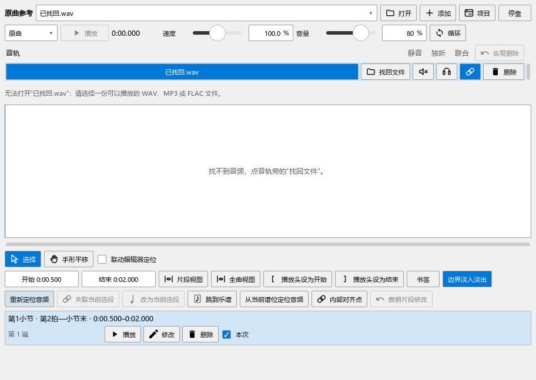
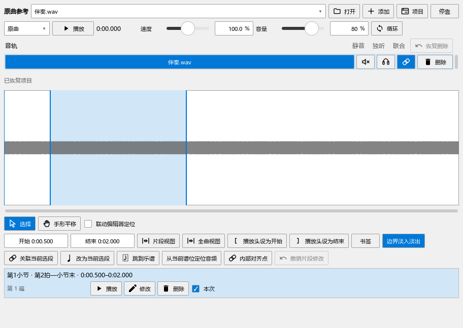
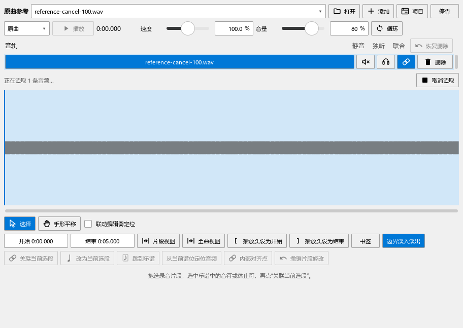

# 文件读取、项目移动与反复关联检查

本批对应0.100.0。测试使用独立乐谱、生成音频和上游的反复谱例；文件均放在E盘。

## 复现与修改

- 重新定位到损坏文件后，旧实现将当前路径换成坏文件，并把原音频时长清零。现读取成功后更新路径、时长和波形；读取失败与取消均保留当前内容。
- 新添加失败的音轨退出本次添加，原来的选轨、片段和关联恢复。状态行提供“取消读取”，缺失音轨旁提供“找回文件”。
- 读取任务按音轨记录用途。读取过程中切到其它轨，找回文件继续保留原关联，更换录音更新原目标轨；另一轨的显示与资料保持原样。
- 遍次不存在时，提示写清请求的遍次、已有遍数和调整入口。有效遍次继续使用宿主的展开反复位置。
- 建立关联后立即保存时，旧实现还在等待界面定时写入，实际谱文件中音轨数为0。现把当前原曲资料接入普通保存、另存和关窗前的保存检查。

## 从找回文件到保存

实际面板先建立第1小节第2拍到小节末的关联。选择损坏WAV，核对原文件、时长和关联仍在；再测试添加同一坏文件，核对返回原轨。

把音频找回到新文件名，保存MSCZ及相对路径。将乐谱和音频复制到新目录，再把旧位置的测试音频移到归档位置，重新打开乐谱，核对从新目录找到音频。随后只带乐谱到另一目录，核对音轨、关联和“找回文件”入口，再重新定位到可读音频。

读取过程中快速切轨，分别核对保留关联与更换录音两种用途。旧版单轨JSON工作区也重新读取，核对音量、片段和关联。

没有打开乐谱时，打开录音并选定片段，再关闭、重新打开原曲参考，核对音频时长、波形范围和片段端点。结果见`reference-100-standalone-performanceeditor-run.txt`。读取回调同时核对所属音轨和当前会话，换谱后的旧任务不会写入新乐谱。

建立关联后立即触发“保存”，重新读取文件核对音轨与拍位；删除关联后立即另存副本，再关闭乐谱并实际点击提示中的“保存”，读回新关联。保存后等待界面定时任务结束，原谱保持已保存状态。复现为`reference-100-save-before-performanceeditor-run.txt`，关窗与另存结果见`reference-100-close-performanceeditor-run.txt`。

取消按钮通过实际鼠标点击。该项把读取任务暂留在工作队列中，确保能看清等待状态；取消后检查原文件与时长。长音频的实际读取另见下一项。

## 三种格式的较长片段

生成180秒的WAV、MP3和FLAC，逐个打开并关联其中90—170秒到40小节乐谱，完整播放这80秒。读取原生声音回调，核对首个声音、末尾和停止位置。

三种格式的首个有效声音均在第23帧，末尾为第3,527,999帧；80秒对应3,528,000帧。源播放头到170秒，片段末尾没有累积错位。本机最终一轮读取约51—59毫秒，联合准备约63—133毫秒；单次输出回调的95%用时约0.055—0.060毫秒。具体逐次值保留在测试日志中。

这里检查的是解码、位置、实际混音数据和软件操作。真实音乐在声卡上的连续听感、实体键盘与音源继续随B5／F检查。

## 反复与跳转

两小节反复中，为同一谱段分别建立第一、第二遍的录音关联。三种联合方式均从第二遍的4320 tick进入，使用录音2.5秒起点；结束后检查两边停下。

一房二房和跳转另用上游`mtest/libmscore/repeat/repeat06.mscx`、`repeat07.mscx`逐个核对展开位置，并从重复出现的一处实际播放。无效的第三遍提供具体提示。

## 记录与后续

复现见`P2/out/reference-100-before-performanceeditor-run.txt`。最终发布内容包含14项流程，加准备、结束共16项通过，记录为`reference-100-final-release-performanceeditor-run.txt`。另有6项窗口与频谱操作，加准备、结束共8项通过，记录为`reference-100-final-ui-pluginhost.txt`。

共同鼠标问题继续按原步骤检查：播放打断时间尺拖动，停止后切换工作视图，再展开符号组、实际应用重音并撤销重做，最后点击原曲参考的循环按钮。两处均能操作，左右侧栏宽度往返保留。截图沿用`palette-after-playback-093.png`，本批已重新生成和查看。

窗口检查仍出现既有的离屏绘制警告；实际控件点击和正式窗口截图已核对。其它本批操作、长片段与反复的日志以`reference-100-*`命名。

B2的软件操作与文件恢复补齐后，下一项进入B3手动扒谱：整首与片段、换轨、缩放、配色、听辨、标注、写谱和缓存。真实设备与音乐的持续使用仍列在B5／F，全部33项见[完整计划](REWORK_PROGRESS.md)。

程序与媒体模块一起发布，个人配置保留，发布定位`personal-v0.100.0`。
