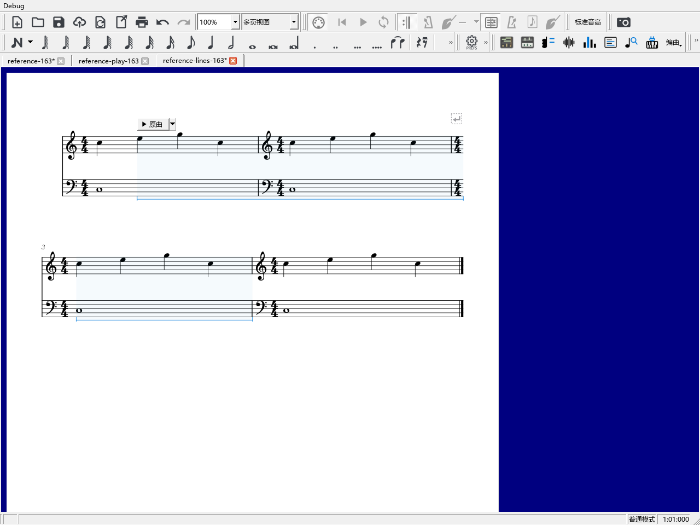

# 在谱面直接播放原曲片段

先在“视图 → 原曲参考”打开录音，选谱中的音符、休止符或一段范围，再选择录音片段，点“关联当前选段”。同一录音可关联到多处，同一谱段也可选择不同录音。

## 播放和选择片段

在原曲参考中开启“谱面播放按钮”。关联起点上方会出现一个小按钮：左边“原曲”直接播放当前片段，右边箭头选择这一处的其它片段。

箭头菜单的每项显示音轨与片段名，勾选表示当前选择。选好后点左边播放。播放中左边显示“停止”，直接点它即可停止；再点一次可以重新播放这个片段。

## 看关联的真实范围

按钮旁的范围设置提供：

- “范围：悬停时显示”：鼠标放到谱面按钮上时，显示当前片段对应的位置。
- “范围：始终显示”：持续显示各处当前选择的范围。
- “范围：播放时显示”：只强调正在播放的关联。

范围以淡色和下方细括号表示，起止对应实际音符、休止或拍位。跨谱行时分行显示，行末的终点仍落在前一行末尾。

## 按钮挡住内容时

拖住按钮左侧移到合适位置。移动只改变按钮摆放，关联范围保持在原来的音乐位置。一次拖动可用Ctrl+Z撤销，Ctrl+Y重做。

箭头菜单里可选“恢复自动位置”或“隐藏此处按钮”。在原曲参考点“恢复谱面按钮”，可以找回隐藏的按钮并恢复自动位置。关闭“谱面播放按钮”会收起所有按钮和范围；以后打开继续使用。

位置和隐藏状态随乐谱保存，重新打开后继续保留。播放中可以停止和选择片段；摆放与隐藏在停止乐谱后保存。

## 改音乐范围或录音时间

在关联列表中选好片段：

1. 需要改谱段时，重新选择谱中的音符、休止或范围，点“改为当前选段”。
2. 需要改录音起止时，点这条关联的“修改”，调整起止时间和内部对齐点。也可用“选段”工具拖动端点。
3. 用“跳到乐谱”检查位置；“撤销片段修改”可以恢复刚才的关联。

分段写法按钮也可拖动移位，在它的菜单中隐藏、恢复；在方案面板可重新开启谱面切换按钮。它与原曲片段各自控制所对应的内容。

发布定位：`personal-v0.163.0`。
