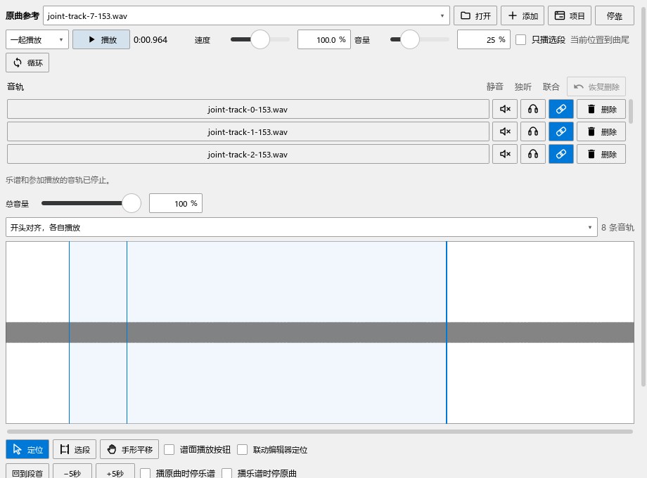

# 多条原曲一起播放，换谱后继续使用

适用于0.152.0及之后版本 · Kumo branch / Freddd13。

## 用人声、伴奏比较同一段乐谱

1. 打开“视图 → 原曲参考”，点“打开”载入人声；再点“添加”载入伴奏。顶部显示当前查看的音轨，下面每行右侧有静音、独听、联合和删除。
2. 选择人声音轨，点波形下方的“选段”，拖出要听的片段。用“开始”“结束”微调；在谱面选择对应的音符或休止符范围，点“关联当前选段”。
3. 选择伴奏音轨，用同样的方法建立对应。两份录音可以使用不同的起止秒数，对应到同一谱段。
4. 需要一起听的音轨开启“联合”。在下方点选一条关联，顶部播放对象选“一起播放”，跟随方式先用“开头对齐，各自播放”，再点“播放”。
5. 播放时可以直接静音、独听或调音量。再次点“停止”，乐谱和参加的音轨一起结束；之后可以重新播放。

“音频跟随乐谱”把录音伸缩到谱中速度；“乐谱跟随选中音频”让乐谱跟着当前录音。中间有快慢变化时，可在“内部对齐点”中指定录音某一刻对应谱子的哪一拍。完整例子见[关联与对齐](REFERENCE_081_GUIDE.md)。

音轨多时，列表内可以上下滚动。删除某一轨用该行“删除”；“恢复删除”取回刚删的轨道和片段。

## 只听原曲，或循环一小段

顶部播放对象选“原曲”，听当前选中的音轨。波形下方“定位”用于点选播放位置；需要重新框出范围时，再切到“选段”。

勾选“只播选段”后，播放使用“开始／结束”的范围；再开“循环”即可反复听它。取消“只播选段”后，从当前播放位置继续听录音。已有范围仍保留，方便稍后比较。

“手形平移”和鼠标中键可移动波形，底部滚动条也能浏览其它位置。点“全曲视图”看整首，点“片段视图”放大当前范围。

## 切换乐谱、关闭面板和保存

切到另一份谱时，当前联合播放结束，原曲面板换成那份谱自己的音轨。返回原谱后恢复原音轨、片段与关联；读取完成即可再播放。关闭原曲面板后，可从“视图 → 原曲参考”重新打开。

按Ctrl+S保存乐谱，轨道路径、关联、内部对齐点、音量和当前选择一起保存。音频文件继续放在原位置；搬动文件后用“重新定位音频”找回。需要单独保存这套参考资料时，用“项目 → 保存工作区”。

分段写法的主组合用于普通MuseScore打开；本分支继续恢复当前组合。分享或导出时的选择见[分段试写](VARIANTS_070_GUIDE.md)。

实际检查结果见[多轨、排版与导出检查](WORKFLOW_EXPORT_153_CHECKS.md)。
